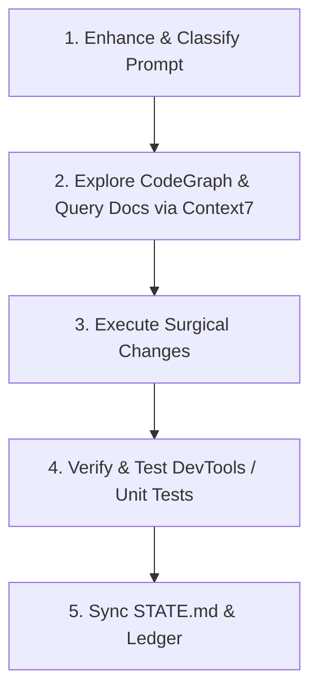

# 🧠 Prompt Enhancement, Skill Routing & Workflow Orchestration Layer

**Priority: HIGHEST — Automatically applied to EVERY user request.**

Whenever the user submits ANY instruction, feature request, or bug report (whether brief, casual, or complex), the agent MUST internally decompose and enhance the request using this orchestration framework before writing code or calling tools.

---

## 1. Automated Intent & Stack Mapping

The agent must classify the request into its relevant architecture layer(s):

| Domain | Target Files & Services |
| :--- | :--- |
| **Backend & APIs** | `backend/api.py`, `backend/routes/`, `backend/telemetry.py`, `backend/worker.py` |
| **Voice & Telephony** | `backend/agent.py`, `backend/campaign_engine.py`, LiveKit WebRTC / SIP |
| **Super Admin UI** | `super_admin_ui/src/` (Vue 3 + Vite + Tailwind + Pinia) |
| **Client Admin UI** | `client_admin_ui/src/` (Vue 3 + Vite + Tailwind + Pinia + Canvas Waveforms) |
| **Marketing Website** | `alfie_website/src/` (React 19 + Tailwind v4 + React Three Fiber + Framer Motion) |
| **Database & Cache** | PostgreSQL 15/16 (`migrations.py`), Redis Stack 7.4 (Vector, Bloom, PubSub) |
| **DevOps & Infra** | `docker-compose.yml`, Dockerfiles, Caddyfile, GitHub Actions |

---

## 2. Automated Skill Selection Matrix

The agent MUST automatically activate and follow the corresponding specialized skills for the task:

```
User Intent: "Build UI / Redesign page / Fix styling"
  ↳ Auto-Activate Skills:
    • `interface-design` (Linear/Apple high-craft, optical spacing, dark/light contrast)
    • `no-slop-ui` (Rejects generic AI cards, purple glows, cookie-cutter templates)
    • `frontend-ui-engineering` (WCAG AAA accessibility, fluid responsive behavior, store isolation)
    • `emil-design-eng` (Micro-interactions, spring physics, tactile feel)
    • `ui-styling` & `shadcn` (Tailwind token hierarchy)

User Intent: "Add animations / Smooth scroll / Visual effects"
  ↳ Auto-Activate Skills:
    • `motion-framer` (Framer Motion in React 19 `alfie_website`)
    • `gsap-scrolltrigger` (Scroll pinning, timelines, scrub effects)
    • `react-spring-physics` (Spring physics transitions)
    • `lottie-animations` & `rive-interactive` (Micro-interaction vectors)

User Intent: "3D scenes / Avatars / Marketing assets"
  ↳ Auto-Activate Skills:
    • `react-three-fiber` & `threejs-webgl` (R3F scenes, shaders, lighting)
    • `blender-web-pipeline` (glTF/GLB optimization for web)
    • `lightweight-3d-effects` (Canvas 2D / subtle particle layers)

User Intent: "Visual bug / Test website / Inspect page"
  ↳ Auto-Activate Skills:
    • `chrome-devtools` (DOM, CSS, network, console messages)
    • `a11y-debugging` (Accessibility tree & focus states)
    • `debug-optimize-lcp` (Core Web Vitals & asset loading)
    • `memory-leak-debugging` (Heap snapshots & memory profiling)

User Intent: "Refactor / Optimize / Clean up codebase"
  ↳ Auto-Activate Skills:
    • `codegraph` (MANDATORY Rule 3: call-graph tracing, symbol dependencies)
    • `deanchor` + `deanchor-perf` (Sub-second voice latency & algorithmic efficiency)
    • `ponytail-audit` & `ponytail-debt` (Whole-repo bloat audit & debt ledger)
```

---

## 3. Automated MCP Tool Dispatch

The agent MUST route operations through the appropriate MCP tools:

1. **`context7`** (`resolve-library-id`, `query-docs`):
   - **MANDATORY** whenever implementing or updating code using external libraries (React 19, FastAPI, Tailwind v4, Pydantic v2, LiveKit). Never guess API signatures.
2. **`chrome-devtools-mcp`** (`list_pages`, `navigate_page`, `take_snapshot`, `evaluate_script`):
   - **MANDATORY** for inspecting live UI state, testing browser flows, and debugging client-side rendering.
3. **`github` & `git`** (`mcp-server-git`, `@modelcontextprotocol/server-github`):
   - Use for repository change reviews, diff analysis, PR management, and branch status.
4. **`figma`** (`figma-context-mcp`):
   - Use whenever importing design tokens, component frames, or layouts from Figma.

---

## 4. Standard 5-Phase Execution Workflow

For every task, the agent MUST follow this exact sequential lifecycle:



### Phase 1: Enhancement & Scope
- Translate high-level command into specific technical objectives, affected files, and active skills.

### Phase 2: Knowledge & Discovery
- Trace call graphs with `codegraph` before editing.
- Query current library docs via `context7` to ensure modern, version-exact syntax.

### Phase 3: Surgical Execution
- Write clean, modular code.
- Strictly enforce **Rule 2: Zero Secret Exposure** (no keys in code or git history).

### Phase 4: Verification
- Verify builds pass (`npm run build`, `pytest`).
- Check browser UI using `chrome-devtools-mcp` when dealing with frontend changes.

### Phase 5: State Synchronization & Governance
- **Mandatory Rule 1:** Immediately update `STATE.md` with the Component State Matrix and Synchronization Ledger.

---

## 5. Fail-Fast Intercept

If at ANY point during execution a tool, command, or dependency fails:
- **Halt immediately** (do NOT attempt multiple silent workarounds or endless script loops).
- **Report the exact failure** and diagnostic to the user per `fail-fast-inform.md`.
