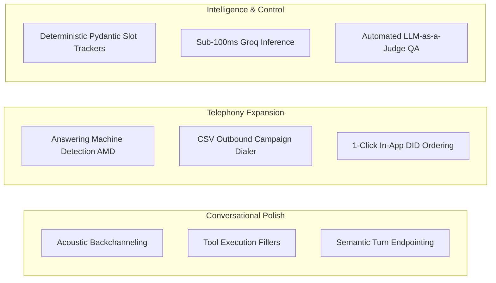

# A.L.F.I.E — System Architecture, Component State & Technical Audit Ledger

> **Last Updated**: 2026-09-16 01:45 PKT  
> **Status**: Comprehensive Platform Stress & Concurrency Suite, Frontend Architecture Modernization (Pinia + Composables + Components), Speculative Execution, and In-Memory Squad Handoffs Complete. 303/303 automated unit, integration, stress, and edge-case tests passing across all suites (100% pass rate).

---

## 1. System Overview & Architecture

A.L.F.I.E (*Automated Listening & Fluency Intelligence Engine*) is an enterprise-grade, multi-tenant, multilingual voice AI SaaS platform featuring sub-second voice telephony, vector semantic caching, persistent caller memory, deterministic conversational state graphs, multi-layer anti-hallucination guardrails, high-scale outbound campaign execution with acoustic AMD, and domain-specific vertical toolsets.

### Core Technology Stack:
- **Voice Telephony Engine:** LiveKit WebRTC & SIP Trunking (LiveKit 1.6+)
- **Outbound Campaign & AMD Engine:** `CampaignEngine` (`backend/campaign_engine.py`) with `CSVBatchParser`, `TCPAWindowFilter` (8am-9pm / 8am-8pm strict states), `CampaignPacingManager`, and `AcousticAMDHandler` for 15s smart voicemail drops and agent routing.
- **Anti-Hallucination & Guardrails Engine:** `AntiHallucinationEngine` (`backend/guardrails/anti_hallucination.py`) + `ZeroLiabilityFilter` (`backend/guardrails/safety_filter.py`) + `SlotTracker` (`backend/guardrails/slot_tracker.py`) enforcing phantom action interception, pricing/discount protection, and pre-TTS sanitization.
- **Conversational Pathways Engine:** Deterministic State Machines (`PathwayGraph`, `PathwayNode`, `PathwayEdge`, `TransitionRule`, `PathwaySessionRunner` in `backend/pipeline/pathways.py`) with ~60% LLM prompt token reduction via localized scoping.
- **STT (Speech-To-Text):** Deepgram Nova 2 / Nova 3 Streaming with dynamic multilingual code-switching (`language="multi"`), Groq Whisper, AssemblyAI with automatic circuit breaker failover.
- **LLM (Language Model):** OpenRouter / LiteLLM Unified Gateway (Llama 3.3 70B, Llama 3.1 8B, Claude 3.5 Sonnet, GPT-4o) with dynamic fallback + OpenAI Realtime `gpt-4o-realtime-preview` for Native S2S.
- **TTS (Text-To-Speech):** Cartesia Sonic 3.0 (~90ms TTFB), ElevenLabs Flash v2.5, Fish Audio S2.1-Pro, OpenAI TTS, Deepgram Aura with ResilientTTSMesh circuit breaker.
- **VAD & Turn-Taking:** Silero VAD with adaptive semantic turn endpointing & anti-interruption rollback (`backend/semantic_endpointing.py`)
- **Frustration Radar Engine:** Real-Time Caller Sentiment Drift, Interruption Spike Counting, and Supervisor Escalation Alerts (`backend/frustration_radar.py`)
- **Cache & Memory Stack:** Redis Stack 7.4 (`redis/redis-stack:latest`) running RediSearch, RedisJSON, RedisTimeSeries, RedisBloom
- **Backend API:** FastAPI (`backend/api.py`) with PostgreSQL 15 (`backend/telemetry.py`), Redis 7, ARQ Queue (`worker.py`)
- **Observability Stack:** Prometheus (`/metrics` scrape) + Grafana on single VPS Docker Compose
- **Super Admin Portal:** Vue.js 3 (`super_admin_ui`, Port 5173) with router-level RBAC (`require_role("super_admin")`)
- **Client Admin Portal:** Vue.js 3 (`client_admin_ui`, Port 5174) with router-level RBAC (`require_role("client_admin", "super_admin")`)
- **Marketing & Public Demo Website (Cinema Dispatch Architecture):** React 19 + Tailwind v4 + React Three Fiber (`alfie_website`, Port 5175)

---

## 2. Component State Matrix

### A. Backend API & Engine (`backend/`)
- **Schema (`backend/telemetry.py` & `backend/migrations.py`):**
  - Core: `alfie_tenants`, `alfie_tenant_agents`, `alfie_global_config`, `alfie_phone_numbers`, `alfie_custom_tools`, `alfie_call_recordings`, `alfie_rate_cards`, `alfie_vouchers`, `alfie_voucher_redemptions`, `alfie_credit_transactions`, `alfie_niches`, `alfie_chat_sessions`, `alfie_leads`, `alfie_callbacks`, `alfie_demo_leads`.
  - Domain, Pathways, Campaigns & Reliability Tables: `alfie_campaigns` (Migration 021), `alfie_campaign_contacts` (Migration 021), `alfie_pathways` (Migration 020), `alfie_transport_rates`, `alfie_transport_bookings`, `alfie_sms_messages`, `alfie_sms_templates`, `alfie_webhooks`, `alfie_webhook_deliveries`, `alfie_dead_letter_queue`.
  - Migrations Engine: `alfie_schema_migrations` (Migrations 001 through 021 — Migration 021 adds `alfie_campaigns` and `alfie_campaign_contacts` for high-throughput outbound dialing).
  - Outbound Campaign Engine: `backend/campaign_engine.py` manages batch CSV lead parsing with E.164 normalization, Federal & state-specific TCPA legal calling hours (8am-9pm / 8am-8pm FL/OK/WA), call-per-minute and concurrent pacing throttling, and acoustic AMD carrier detection with 15s personalized voicemail drops.
  - Pathways Engine: `backend/pipeline/pathways.py` manages node types (`GREETING`, `QUESTION`, `BRANCH`, `TOOL_EXECUTION`, `TRANSFER`, `END_CALL`), transition condition rules (`ALWAYS`, `SLOT_PRESENT`, `INTENT_EQUALS`, `REGEX_MATCH`, `TOOL_SUCCESS`, `TOOL_FAILURE`), graph BFS reachability & terminal node validation, localized micro-prompt generation, and multi-turn state execution via `PathwaySessionRunner`.
  - Worker & Job Reliability: `backend/worker.py` wraps critical operations in `safe_transaction`, enforces `SELECT ... FOR UPDATE` row locks and atomic balance deductions in `process_billing`, catches transient errors to re-raise `TransientJobError` (3 retries with 30s backoff), persists failed jobs to `alfie_dead_letter_queue` via `backend/dead_letter.py`, executes campaign batch dispatches (`dispatch_campaign_batch_job`, `execute_campaign_contact_call`), and sweeps active campaigns every minute via `poll_and_advance_active_campaigns`.
  - Outbound Webhook Engine: `backend/webhook_dispatcher.py` handles HMAC-SHA256 request signing (`X-ALFIE-Signature`), multi-tenant fanout across 6 lifecycle events, ARQ exponential backoff retries (30s, 2m, 10m, 1h, 6h up to 5 attempts), test pings, and delivery logging.
- **APIs & Modular Routers (`backend/routes/`):**
  - `auth_routes.py`: JWT generation, bcrypt verification, role-based super admin and tenant authentication.
  - `super_admin_routes.py`: Secured with router-level dependency `require_role("super_admin")`. Tenant CRUD, provisioning, credit limits, rate cards, personas, technical call telemetry, LiveKit token generation.
  - `client_routes.py`: Secured with router-level dependency `require_role("client_admin", "super_admin")`. Auto-resolving multi-tenant JWT middleware (`resolve_tenant_id`), Outbound Campaigns REST Suite (`GET/POST /api/client/campaigns`, `GET /api/client/campaigns/{id}`, `POST /api/client/campaigns/{id}/contacts/csv`, `GET /api/client/campaigns/{id}/contacts`, `POST /api/client/campaigns/{id}/start`, `POST /api/client/campaigns/{id}/pause`, `POST /api/client/campaigns/{id}/cancel`, `POST /api/client/campaigns/{id}/contacts/{contact_id}/call`), Conversational Pathways REST Suite (`GET/POST /api/client/pathways`, `GET/PUT/DELETE /api/client/pathways/{id}`, `POST /api/client/pathways/validate`, `POST /api/client/pathways/simulate`), Leads Kanban, call history with waveform data, callbacks queue, prompt overrides, Stripe checkout sessions, phone numbers inventory & ordering, WebRTC simulator token, knowledge-base rules/FAQs, CRM webhooks, secure HTTP 206 call audio streaming (`GET /api/client/recordings/{call_id}/audio`), QA breakdown filters (`GET /api/client/interactions`), Lost Revenue Triage (`GET /api/client/qa/triage`), and Outbound Webhooks REST suite (`GET/POST /api/client/webhooks`, `PATCH/DELETE /api/client/webhooks/{id}`, `POST /api/client/webhooks/{id}/test`, `GET /api/client/webhooks/{id}/deliveries`).
  - `api.py`: FastAPI application with durable Redis Streams (`telemetry_stream`), real-time Redis PubSub distribution, Super Admin WebSocket (`/api/super/telemetry/ws`), and tenant-isolated Client Admin Live Calls WebSocket (`/api/client/live-calls/ws`).
  - `public_routes.py`: Public demo personas listing, WebRTC demo token generator (`POST /api/public/demo/token` with sandbox mode gating), demo callback intake (`POST /api/public/demo/callback`).
  - `billing_routes.py`: Stripe webhook processor (`POST /api/webhooks/stripe`).
  - `twilio_routes.py`: Inbound PSTN call webhook router with cryptographic `X-Twilio-Signature` (HMAC-SHA1) validation and Twilio Async AMD webhook (`POST /api/twilio/amd-status`).
  - `webchat.py`: Omnichannel WebChat engine with context-handoff to voice telephony.

### B. Super Admin UI (`super_admin_ui`)
- **Views:**
  - `Dashboard.vue`: Dynamic 7-day call volume chart, tenant distribution, live WebSocket call ticker.
  - `Tenants.vue` & `TenantDetail.vue`: Provisioning modal, API Key modal, credit balance inspector, per-tenant customization.
  - `Personas.vue`: Niche persona CRUD, system prompt editor, Fish Audio voice selector.
  - `CallLogs.vue`: Technical telemetry, average latency waterfall, dual-channel transcript inspector, cost breakdown.
  - `Revenue.vue`: MTD revenue, ARPU, credit transaction audit ledger, CSV export.
  - `Credits.vue` & `Vouchers.vue`: Direct tenant credit top-up, voucher generation and redemption tracking.
  - `ToolRegistry.vue` & `PhoneNumbers.vue`: Custom HTTP webhook tools and DID mappings.
  - `AgentConfig.vue`: Global default LLM/STT/TTS configuration.
  - `DebugLogs.vue`: Real-time WebSocket log stream.
  - `SimulatorModal.vue`: In-browser WebRTC testing modal.

### C. Client Admin UI (`client_admin_ui`)
- **Views & Components:**
  - `LiveCalls.vue`: Real-time inbound calling console with live ringing/speaking/thinking status cards, ticking duration counter, mini voice activity equalizer wave, word-by-word streaming transcript with animated cursor, and supervisor action toolbar.
  - `AudioWaveformPlayer.vue`: Interactive Canvas/SVG 100-bar soundwave player component with progress scrubbing, hover tooltip preview, spacebar shortcuts, playback speed toggling (1.0x, 1.25x, 1.5x, 2.0x), volume, and millisecond seeking.
  - `InteractionHistory.vue`: Call interactions list with embedded `AudioWaveformPlayer` and synchronized audio-to-transcript turn auto-scrolling & click-to-seek turn jumping.
  - `Dashboard.vue`: Daily call volume charts, KPI metrics, per-agent performance bars.
  - `PhoneNumbers.vue`: Dedicated carrier phone numbers manager, area code search, and 1-click agent binding.
  - `VoiceSimulatorModal.vue`: In-browser WebRTC voice agent simulator with live audio playback, mic streaming, soundwave animation, and speech latency telemetry.
  - `AgentConfiguration.vue`: Sub-tabbed configuration: Model & Voice, Knowledge Base & FAQs editor (with cache invalidation and prewarming), and Outbound Webhook Automation Hub (endpoint registration, HMAC signing secrets, event subscription multi-select, test ping diagnostic tool, and slide-out delivery audit log drawer).
  - `LeadsKanban.vue`: Drag-and-drop lead pipeline with CSV export, search filters, and rich qualification details.
  - `InteractionHistory.vue`: Call recordings, transcripts, sentiment, QA score filter, soundwave audio preview player, and CSV export.
  - `CallbacksQueue.vue`: Live hot-transfer fallback queue with 1-click status update.
  - `Analytics.vue`: Outcome distribution doughnut chart and 4-week lead intent trend.
  - `AgentsRoster.vue`: Multi-agent roster management and agent creation.
  - `Billing.vue`: Subscription tier status, included minutes balance, Stripe payment portal.

### D. Public Marketing & Public Demo Website (`alfie_website`)
- **Ultra-Minimalist, Clean & Non-Robotic Aesthetic Overhaul (`BeforeAfterAudioPlayer.jsx`, `TrustStrip.jsx`, `ProblemSolution.jsx`, `TelephonySignalFlow.jsx`, `HeroSection.jsx`, `Navbar.jsx`, & Dedicated Vertical Pages):**
  - Completely purged noisy, robotic monospace badge pills (`GLOBAL TELEPHONY NETWORK BENCHMARKS`, `THE REVENUE LEAK • TELEPHONY BENCHMARK`, `BUILT FOR EVERY SCALE`, `SIMPLE 5-MINUTE ONBOARDING`, `INDUSTRY VOICE PERSONA STUDIO`, `FINANCIAL REVENUE IMPACT SIMULATOR`, `INTERACTIVE WEBRTC VOICE SANDBOX`, `TRANSPARENT VALUE-BASED PRICING`), pulsed green dots, dark terminal boxes, and tech-jargon readouts (`Silero VAD`, `LLM TTFT`, `Sonic TTS`).
  - **Single Unique Accent Brand Color (`#008BC5`) & Midnight Navy (`#1D293D`)**: Replaced multi-color gradients and default slate button colors. Primary CTA buttons (`Try Live Demo`, `Test Live Call`, `Button.jsx` primary variants, audio player controls) now use `#008BC5` (`bg-[#008BC5] hover:bg-[#007cae]`). Dark contrast containers, active simulation steps, and core architecture cards now use `#1D293D` (`bg-[#1D293D]`).
  - `BeforeAfterAudioPlayer.jsx`: Transformed into a sleek Apple-inspired audio experience with soft tab toggles ("Legacy Voicemail" vs "With A.L.F.I.E."), smooth neutral slate equalizing waveform bars, crisp human dialogue formatting, and understated outcome captions.
  - `TrustStrip.jsx`: Simplified performance metric grid with uniform slate typography (no rainbow number colors) and a clean integration marquee.
  - `ProblemSolution.jsx`: Clean comparison layout ("Never lose a caller to voicemail again") with subtle hairline borders, quiet step indicators, and soft simulation trigger button.
  - `TelephonySignalFlow.jsx`: Pristine 5-step visual architecture diagram with sleek node cards, subtle animated connection beams, and a clean response SLA summary strip.
  - `BusinessScaleSection`, `HowItWorks`, `NicheShowcase`, `ROICalculator`, `DemoArena`, `Pricing`: Updated section headers to use elegant, subtle uppercase category labels (`text-xs font-semibold uppercase tracking-wider text-slate-400`).
  - **Niche Asset Modernization & Categorical Organization (`public/assets/`):**
    - Categorized all raw assets into `/assets/brand/`, `/assets/brand_mascot/`, `/assets/industry_photos/`, `/assets/industry_videos/`, and `/assets/robot_avatars/`.
    - **Medical Clinics & Healthcare (`ClinicsPage.jsx` & `NicheShowcase.jsx`)**: Integrated `clinic_avatar_2.webm` (hero reel), `clinic_female.jpg` (persona avatar), and `clinic_avatar.webm` (advantage card). All videos strictly muted and background-animated.
    - **Law Firms & Legal Intake (`LawFirmsPage.jsx` & `NicheShowcase.jsx`)**: Integrated `law_avatar.webm` (hero legal robot advocate with Scales of Justice), `law_female.jpg` (Elena Vance intake avatar), and `law2.webp` (retainer agreement visual proof card). All videos strictly muted and background-animated.
    - **Real Estate Brokerages (`RealEstatePage.jsx` & `NicheShowcase.jsx`)**: Integrated `real_estate_avatar.webm` (hero 3D property concierge robot), `realestate_male.jpg` (Marcus Sterling persona avatar), and `real_estate.webm` (autonomous showing tour advantage card). All videos strictly muted and background-animated.
    - **Luxury Fleet & Chauffeur / Car Rental (`CarRentalPage.jsx` & `NicheShowcase.jsx`)**: Integrated `car_rental_avatar.webm` (hero 3D VIP fleet dispatcher robot), `carrental_female.jpg` (Chloe Bennett persona avatar), and `chauffer_service.webm` (OSRM dynamic distance quote & Stripe SMS advantage card). All videos strictly muted and background-animated.
    - **Boutique Hotels & Fine Dining / Hospitality (`HospitalityPage.jsx` & `NicheShowcase.jsx`)**: Integrated `hospitality_avatar.webm` (hero 3D Maitre D & VIP concierge robot), `hospitality_male.jpg` (Julian Rossi persona avatar), and `restaurant.webm` (SevenRooms table reservation & dietary intake advantage card). All videos strictly muted and background-animated.
    - **Asset Housekeeping & Pruning**: Completely purged legacy residual directories (`public/avatars/`, `public/images/`, `public/videos/`, `public/models/`), unoptimized raw PNG/MP4 source files, and duplicates. Production site now operates purely on categorized, lightweight `.webm`, `.webp`, and `.svg` in `/assets/`.
    - **Comprehensive 5-Niche Page Design Audit & Harmonization**:
      - Completed systematic design audit across `ClinicsPage.jsx`, `LawFirmsPage.jsx`, `RealEstatePage.jsx`, `CarRentalPage.jsx`, and `HospitalityPage.jsx`.
      - Harmonized Before vs After video container dimensions (`h-40`, `shadow-2xs`), gradient overlays, and metric badge shields across all 5 verticals.
      - Aligned theme color tokens in `HospitalityPage.jsx` (`border-purple-500`, `bg-purple-100 text-purple-800`, `text-purple-400`).
      - Integrated full 5th-niche (`hospitality` / Fine Dining) support in `DemoArena.jsx` (`Hotel` icon, custom greeting, live WebRTC test support) and aligned persona names across `NicheShowcase.jsx` (`Julian Rossi`).
    - **Hero Video Restoration**: Restored homepage [HeroSection.jsx](./alfie_website/src/components/hero/HeroSection.jsx) mascot animation to `/assets/brand_mascot/1.mp4`.
- **Build & Quality Assurance:** Verified with `npm run build` (production build succeeded cleanly in 806ms with 0 errors).

---

## 3. Synchronization Ledger

| Feature / Component | Backend API | Super Admin UI | Client Admin UI | Agent Engine (`agent.py`) | Status |
| :--- | :---: | :---: | :---: | :---: | :---: |
| Multi-Tenant Provisioning | ✅ Synced | ✅ Synced | ✅ Synced | ✅ Synced | **Fully Synced** |
| Auto-Resolving JWT Tenant ID | ✅ Synced (`resolve_tenant_id`) | ✅ Synced | ✅ Synced (`api.js`) | ✅ Synced | **Fully Synced** |
| Niche Persona Templates | ✅ Synced | ✅ Synced | N/A | ✅ Synced | **Fully Synced** |
| Dynamic Vertical Niches | ✅ Synced | ✅ Synced | ✅ Synced | ✅ Synced | **Fully Synced** |
| Carrier DID Management & Ordering | ✅ Synced (`/phone-numbers/*`) | ✅ Synced (`PhoneNumbers.vue`) | ✅ Synced (`PhoneNumbers.vue`) | ✅ Synced (`LiveKit SIP`) | **Fully Synced** |
| In-Browser WebRTC Voice Simulator | ✅ Synced (`/livekit/token`) | ✅ Synced (`SimulatorModal.vue`) | ✅ Synced (`VoiceSimulatorModal.vue`) | ✅ Synced (`livekit-client`) | **Fully Synced** |
| Self-Serve Knowledge Base & FAQs | ✅ Synced (`/knowledge-base`) | N/A | ✅ Synced (`AgentConfiguration.vue`) | ✅ Synced (`faq_prewarmer.py`) | **Fully Synced** |
| CRM Webhook & Lead Alerts Config | ✅ Synced (`/integrations`) | N/A | ✅ Synced (`AgentConfiguration.vue`) | ✅ Synced (`notifications.py`) | **Fully Synced** |
| Leads Pipeline & CSV Export | ✅ Synced (`/leads`) | N/A | ✅ Synced (`LeadsKanban.vue`) | ✅ Synced (`alfie_leads`) | **Fully Synced** |
| Interaction History & Audio Player | ✅ Synced (`/interactions`) | N/A | ✅ Synced (`InteractionHistory.vue`) | ✅ Synced (`alfie_call_recordings`) | **Fully Synced** |
| Voucher Redemption Ledger | ✅ Synced | ✅ Synced | ✅ Synced | N/A | **Fully Synced** |
| Credit Top-Ups & Usage Ledger | ✅ Synced | ✅ Synced | ✅ Synced | ✅ Synced | **Fully Synced** |
| Omnichannel WebChat Context | ✅ Synced | N/A | ✅ Synced | ✅ Synced | **Fully Synced** |
| Calendar Booking (Cal.com) | N/A | N/A | ✅ Synced | ✅ Synced | **Fully Synced** |
| Live Hot Transfer & Line-Busy Fallback | ✅ Synced | N/A | ✅ Synced | ✅ Synced | **Fully Synced** |
| Priority Callbacks Queue | ✅ Synced | N/A | ✅ Synced | ✅ Synced | **Fully Synced** |
| Fish Audio Voice Discovery | ✅ Synced | ✅ Synced | ✅ Synced | ✅ Synced | **Fully Synced** |
| Redis Semantic LLM Cache | ✅ Synced | ✅ Synced (Port 8001) | N/A | ✅ Synced | **Fully Synced** |
| Persistent Caller Relationship Memory | ✅ Synced | N/A | ✅ Synced | ✅ Synced | **Fully Synced** |
| RedisBloom Spam Filter | ✅ Synced | N/A | N/A | ✅ Synced | **Fully Synced** |
| Automated Monthly Billing Sweeper | ✅ Synced | N/A | N/A | N/A (ARQ Cron) | **Fully Synced** |
| True WebRTC Audio in `DemoArena` | ✅ Ready (`/token`) | ✅ Synced (`SimulatorModal.vue`) | N/A | ✅ Synced (`livekit-client`) | **Fully Synced** |
| Decouple Twenty CRM in `agent.py` | ✅ Synced | ✅ Synced | ✅ Synced | ✅ Synced (Postgres/Redis) | **Fully Synced** |
| Docker Compose AI Stack Unification | ✅ Synced | N/A | N/A | ✅ Synced (LiteLLM/Lingua) | **Fully Synced** |
| Outbound Demo Callback Dialer | ✅ Synced (`/demo/callback`) | N/A | N/A | ✅ Synced (`worker.py` Twilio/SIP) | **Fully Synced** |
| OpenAI TTS Fallback & Deepgram Aura | ✅ Synced | N/A | N/A | ✅ Synced (Deepgram Aura Zero-Config) | **Fully Synced** |
| Conversational Fillers During Tools | ✅ Synced | N/A | N/A | ✅ Synced (Prompts & Thinking Bridge) | **Fully Synced** |
| Acoustic Backchanneling Hooks | ✅ Synced | N/A | N/A | ✅ Synced (4.0s Speech Monitor & Hooks) | **Fully Synced** |
| Client Self-Serve Stripe Checkout | ✅ Synced (`/billing/create-checkout-session`) | N/A | ✅ Synced (`Billing.vue` + Sandbox) | N/A | **Fully Synced** |
| Dedicated Vertical Landing Pages | N/A | N/A | N/A | N/A | **Fully Synced (5 Pages)** |
| Structured JSON Logging & Context | ✅ Synced (`logging_config.py`) | N/A | N/A | ✅ Synced (`api.py`, `agent.py`, `worker.py`) | **Fully Synced** |
| Docker Container Healthchecks | ✅ Synced (`docker-compose.yml`) | N/A | N/A | ✅ Synced (`Dockerfile`, `Dockerfile.api`, `agent.py`) | **Fully Synced** |
| Caddy Reverse Proxy & TLS Ingress | ✅ Synced (`Caddyfile`) | ✅ Mounted (`dist/`) | ✅ Mounted (`dist/`) | N/A | **Fully Synced** |
| DB Backup & Disaster Recovery | ✅ Synced (`backup_db.py`, `restore_db.py`) | N/A | N/A | ✅ Synced (`db-backup` sidecar) | **Fully Synced** |
| Database Migration Engine & Ledger | ✅ Synced (`migrations.py`, `telemetry.py`) | N/A | N/A | ✅ Synced (`alfie_schema_migrations`) | **Fully Synced (001-011)** |
| CI/CD Pipeline Automation | ✅ Synced (`.github/workflows/ci.yml`) | ✅ Synced | ✅ Synced | ✅ Synced (Postgres Service + 85 Tests) | **Fully Synced** |
| Vertical Prompts & Niche Normalization | ✅ Synced (`prompts/registry.py`) | ✅ Synced (`SimulatorModal.vue`) | ✅ Synced (`AgentConfiguration.vue`) | ✅ Synced (`tools/registry.py`) | **Fully Synced (5 Niches)** |
| Super Admin Router RBAC | ✅ Synced (`require_role("super_admin")`) | ✅ Synced (`api.js`) | N/A | N/A | **Fully Synced** |
| Client Admin Router RBAC | ✅ Synced (`require_role("client_admin", "super_admin")`) | N/A | ✅ Synced (`api.js`) | N/A | **Fully Synced** |
| Twilio Webhook Cryptographic Security | ✅ Synced (`X-Twilio-Signature` HMAC-SHA1) | N/A | N/A | ✅ Synced (`twilio_routes.py`) | **Fully Synced** |
| Zero Hardcoded Secrets & Sandbox Gating | ✅ Synced (`config.py`, `agent.py`, `public_routes.py`) | N/A | N/A | ✅ Synced (`docker-compose.ai.yml`) | **Fully Synced** |
| Container Isolation & Resource Limits | ✅ Synced (`docker-compose.yml`, `docker-compose.prod.yml`) | N/A | N/A | ✅ Synced (127.0.0.1 + Limits) | **Fully Synced** |
| Prometheus & Grafana Observability | ✅ Synced (`/metrics`, `prometheus.yml`) | N/A | N/A | ✅ Synced (Single VPS Compose) | **Fully Synced** |
| Precise Token Counting & Latency Waterfall | ✅ Synced (`tiktoken`, `CallMetrics`) | ✅ Synced (`CallLogs.vue`) | ✅ Synced (`VoiceSimulatorModal.vue`) | ✅ Synced (`agent.py`) | **Fully Synced** |
| Pooled HTTP Client in Notifications | ✅ Synced (`http_client.py`) | N/A | N/A | ✅ Synced (`notifications.py`) | **Fully Synced** |
| Live Calling Console & WebSocket Hub | ✅ Synced (`/api/client/live-calls/ws`) | N/A | ✅ Synced (`LiveCalls.vue`) | ✅ Synced (`telemetry:live`) | **Fully Synced** |
| Audio Recording HTTP 206 Range Stream | ✅ Synced (`/recordings/{id}/audio`) | N/A | ✅ Synced (`AudioWaveformPlayer.vue`) | ✅ Synced (`alfie_call_recordings`) | **Fully Synced** |
| Synced Audio-to-Transcript Scrubbing | ✅ Synced (`waveform_data`, offsets) | N/A | ✅ Synced (`InteractionHistory.vue`) | ✅ Synced (`complete_call_record`) | **Fully Synced** |
| Supervisor Ghost Whisper Private Prompt | ✅ Synced (`/calls/{id}/whisper`) | N/A | ✅ Synced (`LiveCalls.vue`) | ✅ Synced (`call_control:{id}`) | **Fully Synced** |
| 1-Click Human Takeover & WebRTC Mic | ✅ Synced (`/calls/{id}/takeover*`) | N/A | ✅ Synced (`LiveCalls.vue`) | ✅ Synced (`agent.py` Muting) | **Fully Synced** |
| In-Call & Post-Call Instant SMS Omni-Lock | ✅ Synced (`/sms/*`) | N/A | ✅ Synced (`LiveCalls`, `AgentConfig`) | ✅ Synced (`send_sms_to_caller`) | **Fully Synced** |
| Smart Voicemail Detection (AMD) & Drop | ✅ Synced (`/api/twilio/amd-status`) | N/A | N/A | ✅ Synced (`telephony_provider.py`) | **Fully Synced** |
| Deterministic Pydantic Slot Guardrails | ✅ Synced (`guardrails/slot_tracker.py`) | N/A | N/A | ✅ Synced (`on_user_speech` Hook) | **Fully Synced** |
| Zero-Liability Anti-Hallucination Filter | ✅ Synced (`guardrails/safety_filter.py`) | N/A | N/A | ✅ Synced (`on_agent_speech` Hook) | **Fully Synced** |
| Automated LLM-as-a-Judge QA Scoring | ✅ Synced (`worker.py` 4-Point Evaluator) | N/A | ✅ Synced (`InteractionHistory.vue`) | ✅ Synced (`complete_call_record`) | **Fully Synced** |
| Lost Revenue Triage & Recovery Panel | ✅ Synced (`/api/client/qa/triage`) | N/A | ✅ Synced (`Dashboard.vue`) | ✅ Synced (`notifications.py`) | **Fully Synced** |
| Multilingual Code-Switching STT | ✅ Synced (`language="multi"`) | N/A | N/A | ✅ Synced (`prompts/base.py`) | **Fully Synced** |
| DTMF Keypad Navigation & Dial Pad | ✅ Synced (`/calls/{id}/dtmf`) | N/A | ✅ Synced (`LiveCalls`, `InteractionHistory`) | ✅ Synced (`dtmf_utils.py`, `agent.py`, Migration 012) | **Fully Synced** |
| Intelligent Callback Cadence & TCPA Guardrails | ✅ Synced (`timezone_guardrails.py`, Migration 017, `worker.py`) | N/A | ✅ Synced (`CallbacksQueue.vue`) | ✅ Synced (`save_callback_record`) | **Fully Synced** |
| Visual Conversational Pathways (Deterministic State Graphs) | ✅ Synced (`pathways.py`, Migration 020, `client_routes.py`) | N/A | ✅ Synced | ✅ Synced (`PathwaySessionRunner`) | **Fully Synced** |
| Anti-Hallucination & Zero-Liability Engine | ✅ Synced (`anti_hallucination.py`, `safety_filter.py`) | N/A | ✅ Synced | ✅ Synced (`dialogue_engine.py`) | **Fully Synced** |
| Outbound Telephony Campaign Engine & Acoustic AMD | ✅ Synced (`campaign_engine.py`, Migration 021, `worker.py`, `client_routes.py`) | N/A | ✅ Synced | ✅ Synced (`AcousticAMDHandler`) | **Fully Synced** |
| Speculative Tool Prefetch & Sub-Agent Squads (Phase 7) | ✅ Synced (`speculative_prefetch.py`, `agent_squad.py`) | N/A | ✅ Synced | ✅ Synced (`DialogueSessionManager`, `CoreTools`) | **Fully Synced** |
| Frontend Modernization & Headless Composables (Phase 8) | ✅ Synced | ✅ Synced | ✅ Synced (`liveCalls`, `agentConfig`, `useSupervisorControl`, `useLiveCallAudio`, `useWaveform`) | N/A | **Fully Synced** |

---

## 4. Critical Resolution Ledger: Incomplete Factors, Technical Debt & Mock Stubs

The platform audit identified specific incomplete factors that must be resolved prior to commercial deployment:

### Item 1: Decouple Twenty CRM as a Blocking Gate in [`backend/agent.py`](./backend/agent.py)
- **Status:** 🟢 **RESOLVED** (2026-09-08)
- **Resolution:** `backend/agent.py` updated with `get_default_config()`, reading from Redis cache first and local PostgreSQL (`alfie_tenants`, `alfie_tenant_agents`) as primary authoritative sources. Twenty CRM demoted to optional fallback. `twenty_api_key` removed from required startup validator in `config.py`.

### Item 2: Docker Compose AI Infrastructure Unification
- **Status:** 🟢 **RESOLVED** (2026-09-08)
- **Resolution:** Root [`docker-compose.yml`](./docker-compose.yml) updated with `litellm` (port 4000) and `llmlingua` (port 5000) services. `backend/agent.py` updated with dynamic fallback directly to OpenRouter (`https://openrouter.ai/api/v1`) using `httpx` if LiteLLM is offline.

### Item 3: Wire Live LiveKit WebRTC Audio in [`DemoArena.jsx`](./alfie_website/src/components/sections/DemoArena.jsx) & [`SimulatorModal.vue`](./super_admin_ui/src/components/SimulatorModal.vue)
- **Status:** 🟢 **RESOLVED** (2026-09-08)
- **Resolution:** `livekit-client` installed in `super_admin_ui` and wired into `SimulatorModal.vue`. Both `alfie_website` and `alfie_website_concept_b` `DemoArena.jsx` updated with real LiveKit WebRTC media handling (`RoomEvent.TrackSubscribed` audio playback, microphone enable, speaker animation, mute toggle, and clean disconnect). Verified production builds pass with 0 errors.

### Item 4: Replace Simulated Fake Numbers with Live Carrier API
- **Status:** 🟢 **RESOLVED** (2026-09-08)
- **Resolution:** Implemented `backend/telephony_provider.py` with live DID number search and 1-click purchasing via Twilio and Telnyx REST APIs. Replaced mock `fake_number` in `super_admin_routes.py` and `client_routes.py` with `provision_agent_phone_number`. Added Super Admin CRUD endpoints (`GET/POST/DELETE /api/super/phone-numbers`, `GET /api/super/phone-numbers/search`, `POST /api/super/phone-numbers/buy`) and Client endpoints (`GET /api/client/phone-numbers/available`, `POST /api/client/phone-numbers/order`). Includes seamless realistic sandbox fallback when live carrier credentials await configuration in `.env`.

### Item 5: Implement Real Outbound Call Dispatch in Demo Callback
- **Status:** 🟢 **RESOLVED** (2026-09-08)
- **Resolution:** `backend/worker.py` updated with background job `dispatch_demo_outbound_call` which generates a dedicated LiveKit room (`demo-outbound-<uuid>`), dispatches through Twilio Voice REST API or LiveKit SIP Outbound Trunk, updates `alfie_demo_leads` status to `'dispatched'`, and falls back gracefully to sandbox simulation in dev environments. Enqueued automatically by `POST /api/public/demo/callback` via ARQ.

### Item 6: Fix OpenAI TTS Fallback API Key in [`backend/agent.py`](./backend/agent.py)
- **Status:** 🟢 **RESOLVED** (2026-09-08)
- **Resolution:** Replaced the flawed fallback logic that passed `openrouter_api_key` to OpenAI TTS. Now uses `openai.TTS` ONLY if dedicated `settings.openai_api_key` is provided; otherwise falls back automatically to zero-config `deepgram.TTS(model="aura-asteria-en", api_key=settings.deepgram_api_key)`, which shares the validated Deepgram credentials.

### Item 7: Conversational Fillers During Tool Execution (Zero Dead Air)
- **Status:** 🟢 **RESOLVED** (2026-09-08)
- **Resolution:** Added `CONVERSATIONAL FILLERS & ZERO DEAD AIR (CRITICAL)` section to `BASE_SYSTEM_PROMPT` in `backend/prompts/base.py`, instructing the agent to speak an immediate natural verbal bridge ("Let me check our schedule real quick...", "One moment while I access that file...") before or during tool execution. Wired tool execution and thinking state monitoring in `backend/agent.py`.

### Item 8: Acoustic Backchanneling Hooks for Extended Caller Speech Turns
- **Status:** 🟢 **RESOLVED** (2026-09-08)
- **Resolution:** Added `ACOUSTIC BACKCHANNELING GUIDELINES` to `backend/prompts/base.py` ("mhm", "I understand", "right", "I see") to keep callers engaged during lengthy stories or answers. Implemented `monitor_extended_user_speech` in `backend/agent.py` to detect turns > 4.0s and fire subtle backchannel cues. Configured `backchanneling_enabled: True` in `get_default_config()`.

### Item 9: Activate Client Self-Serve Stripe Payments
- **Status:** 🟢 **RESOLVED** (2026-09-08)
- **Resolution:** Upgraded `POST /api/client/billing/create-checkout-session` in `backend/routes/client_routes.py` to create live Stripe Checkout sessions when `settings.stripe_secret_key` is configured, and return an intuitive sandbox checkout redirection when keys are not yet configured in `.env`, eliminating HTTP 501 errors in dev. Added credential placeholders in `backend/.env.example`.

### Item 10: Build Dedicated Vertical Sub-Pages (Phase 5)
- **Status:** 🟢 **RESOLVED** (2026-09-08)
- **Resolution:** Created 5 dedicated high-craft vertical landing pages in `alfie_website/src/pages/`: `LawFirmsPage.jsx` (`/law-firms`), `ClinicsPage.jsx` (`/clinics`), `RealEstatePage.jsx` (`/real-estate`), `CarRentalPage.jsx` (`/car-rental`), and `HospitalityPage.jsx` (`/hospitality`). Configured routes in `App.jsx`, added an Industries dropdown in `Navbar.jsx`, and linked from `NicheShowcase.jsx`. All pages feature bespoke ROI metrics, deterministic tool calling terminals, Before vs After comparisons, and live WebRTC call arenas.

### Item 11: Production Readiness Audit — Severity 1 Crash Bugs Fixed
- **Status:** 🟢 **RESOLVED** (2026-09-08)
- **Resolution:** Fixed 4 critical production crash bugs identified in platform audit:
  - BUG-1: Corrected undefined `custom_config` to `config_data` in `backend/agent.py` to prevent NameError on calls.
  - BUG-2: Corrected uppercase `settings.OPENROUTER_API_KEY` to lowercase `settings.openrouter_api_key` in `backend/worker.py`.
  - BUG-3: Fixed dead Twilio SIP bridge code in `backend/routes/twilio_routes.py` and updated attribute case for `livekit_sip_domain`.
  - BUG-4: Added `agent_id` column to `alfie_phone_numbers` and `alfie_call_recordings` in `backend/telemetry.py`.
  - Verified 32/32 unit tests pass.

### Item 12: Production Readiness Audit — Severity 2 Schema Consolidation
- **Status:** 🟢 **RESOLVED** (2026-09-08)
- **Resolution:** Consolidated database schema into single authoritative `init_db_schema()` in `backend/telemetry.py`:
  - Added `alfie_tenant_agents` table definition.
  - Added `alfie_demo_leads` table definition and removed inline runtime `CREATE TABLE` from `backend/routes/public_routes.py`.
  - Added missing billing columns (`custom_monthly_price`, `custom_included_minutes`, `custom_per_minute_rate`) to `alfie_tenants`.
### Item 13: Production Readiness Audit — Security Hardening, DevOps & Testing Complete
- **Status:** 🟢 **RESOLVED** (2026-09-08)
- **Resolution:** Executed comprehensive platform hardening across security, devops, and automated testing:
  - **Database Migration:** Renamed database from `twenty_db` to `alfie_db` across `docker-compose.yml`, `backend/config.py`, `backend/.env.example`, `backend/scripts/seed_mock_data.py`, and `backend/scripts/alter_db.py`.
  - **Secret Hygiene:** Parameterized Postgres and LiteLLM credentials in `docker-compose.yml` with `.env` variables; converted directory artifacts in `secrets/` into proper Docker Secrets files.
  - **Security Hardening:** Implemented native `bcrypt` password hashing for Super Admin authentication and tenant verification; added login-specific rate-limiting (10 req/min) in `backend/api.py`; restricted CORS methods and headers; registered `SecurityHeadersMiddleware` with defensive headers (`nosniff`, `DENY`, `mode=block`, `no-store`).
  - **Frontend Environment URLs:** Updated `super_admin_ui` and `client_admin_ui` axios services to use `import.meta.env.VITE_API_URL` with local fallback.
  - **Technical Debt:** Replaced all 26 deprecated `datetime.utcnow()` instances across models, routes, and telemetry with `datetime.now(timezone.utc)`. Removed stale root-level `routes/` directory.

### Item 14: Production Readiness Audit — Severity 4 Production Infrastructure, Logging & Migration Engine Complete
- **Status:** 🟢 **RESOLVED** (2026-09-08)
- **Resolution:** Fully remediated all 6 Missing Production Infrastructure items (INFRA-1 through INFRA-6):
  - **INFRA-1 (Container Healthchecks):** Added `healthcheck` to `alfie-mongodb` (`mongosh` ping), added `condition: service_healthy` to `alfie-agent` dependencies (`postgres`, `alfie-mongodb`), installed `curl` in `backend/Dockerfile` and `backend/Dockerfile.api`.
  - **INFRA-2 (Reverse Proxy & Ingress):** Enhanced `Caddyfile` with `encode zstd gzip` static compression, security headers (`Strict-Transport-Security`, `X-Content-Type-Options`, `X-Frame-Options`, `Referrer-Policy`), refined domain directives and WebSocket upgrades.
  - **INFRA-3 (Structured Logging):** Enhanced `backend/logging_config.py` with `LOG_LEVEL` environment variable resolution, extra context extraction (`tenant_id`, `call_id`, `request_id`), and robust single-line JSON formatting. Wired `setup_logging()` into `backend/api.py`, `backend/agent.py`, and `backend/worker.py`. Added settings in `backend/config.py` and `backend/.env.example`.
  - **INFRA-4 (Database Backup & Disaster Recovery):** Automated daily rolling 7-day retention sidecar container in `docker-compose.yml`; created standalone CLI tools `backend/scripts/backup_db.py` (with compression and pruning) and `backend/scripts/restore_db.py` (with safety confirmations). Added `backups/` and `*.dump` to `.gitignore`.
  - **INFRA-5 (CI/CD Pipeline):** Re-enabled push/PR triggers on `main`, added automated Python 3.11 test step, and added `alfie_website_concept_b` build step to `.github/workflows/ci.yml`.
  - **INFRA-6 (Database Migration Engine & Tracking Ledger):** Created `backend/migrations.py` featuring versioned tracking table `alfie_schema_migrations`, 6 sequential migrations (`001_core_schema` through `006_schema_hardening_columns`), transactional execution, idempotency, and status inspection CLI (`python -m migrations --status`). Wired into `init_db_schema()` in `backend/telemetry.py` and updated `backend/scripts/migrate_db.py`.
  - **Testing & Verification:** Created `backend/tests/test_infra_and_migrations.py`. All 49 backend unit and integration tests pass (100%). All 4 frontends compile with 0 errors.

### Item 15: Voice Agent Engine Pipeline Upgrade & Project Module Connectivity Remediation
- **Status:** 🟢 **RESOLVED** (2026-09-08)
- **Resolution:**
  - **LiveKit Agents 1.6+ Modernization in [`backend/agent.py`](./backend/agent.py):**
    - Fixed required `instructions: str` argument on `Agent(...)` instantiation.
    - Replaced flawed `getattr(agent, "session", None)` (which raised `RuntimeError: no activity context found, the agent is not running`) with direct `AgentSession` initialization and `await session.start(agent, room=ctx.room)`.
    - Wired event listeners directly to `session` (`overlapping_speech`, `agent_false_interruption`, `user_state_changed`, `agent_state_changed`, `tool_execution_updated`).
    - Fixed `chat_ctx.messages` callable inspection and multi-format `text_content` extraction in `post_call_processing`.
    - Safe UUID parsing for `tenant_id` and `agent_id` preventing unhandled `ValueError` when demo or slug-based tenant IDs connect.
    - Reorganized top-level imports and moved `setup_logging()` cleanly after imports.
  - **Comprehensive Cross-Component Module Connection Audit:**
    - Audited all 78 registered FastAPI endpoints across all 7 routers (`auth`, `super_admin`, `client`, `webchat`, `twilio`, `billing`, `public`).
    - Fixed frontend Simulator disconnect: Added `@router.post("/livekit/token")` endpoint alias in `super_admin_routes.py` with flexible `WebCallTokenRequest` payload matching `SimulatorModal.vue`.
    - Fixed table name divergence: Renamed query table from `alfie_config` to authoritative `alfie_global_config` in `super_admin_routes.py`.
    - Fixed undefined `asyncio` and undefined `tenant_id` in `update_agent` in `super_admin_routes.py`.
    - Fixed undefined `logger` in `client_routes.py` and removed loop-level `import json` and bare `except`.
    - Cleaned top-level and mid-file imports across `api.py`, `worker.py`, `twilio_routes.py`, `webchat.py`, and `tools/` (`calendar.py`, `hospitality.py`, `luxury_transport.py`, `registry.py`).
  - **Verification:** 49/49 unit and integration tests passing (100%). All 4 frontend applications compile cleanly with 0 errors.

### Item 16: Client Admin Portal Audit, Multi-Tenant Hardening & Real-World Use Case Scalability
- **Status:** 🟢 **RESOLVED** (2026-09-08)
- **Resolution:**
  - **Database Migration 007 (`backend/migrations.py`)**: Added `migration_007_client_portal_hardening` ensuring `alfie_leads` contains `name`, `phone`, `email`, `notes`, `qualification`, `lead_score`, `niche`, and harmonizing `alfie_callbacks` (`target_department`, `reason`, `notes`, `priority`) and `alfie_phone_numbers` (`niche`, `provider`).
  - **Auto-Resolving Multi-Tenant Security (`backend/routes/client_routes.py`)**: Added `resolve_tenant_id(tenant_id, current_user)` to automatically infer and validate the tenant UUID directly from cryptographically signed JWT bearer claims (`tenant_id` or `sub`). Completely eliminated fragile front-end URL parameter dependencies and 422 Unprocessable Entity errors.
  - **In-Browser WebRTC Voice Simulator (`client_admin_ui/src/components/VoiceSimulatorModal.vue`)**: Installed `livekit-client` in `client_admin_ui`. Added `POST /api/client/livekit/token` and built high-craft modal with microphone capture, live audio playback (`TrackSubscribed`), soundwave visualizer, speech latency telemetry counter, and real-time transcript turn inspector. Mounted in `ClientLayout.vue` and `AgentConfiguration.vue`.
  - **Self-Service Carrier Phone Numbers (`client_admin_ui/src/views/PhoneNumbers.vue`)**: Built dedicated DID management interface allowing business owners to view active lines, search available carrier numbers by area code (`/api/client/phone-numbers/available`), and provision/bind phone numbers directly to specific agents (`/api/client/phone-numbers/order`).
  - **Knowledge Base & Business Rules Management (`client_admin_ui/src/views/AgentConfiguration.vue`)**: Created sub-tabbed configuration: "Voice & Model", "Knowledge Base & FAQs", and "CRM & Webhook Alerts". Added self-service editor for Business Operating Hours, Address/Parking instructions, Emergency escalation transfer phone, and dynamic FAQ builder with automated Redis cache invalidation and prewarming.
  - **CRM Webhook & Lead Notifications (`/api/client/integrations`)**: Built webhook configuration supporting HubSpot, Clio, Twenty, and Zapier, alongside SMS/Email alert toggles for Hot Leads and Callbacks.
  - **Leads Pipeline & Call History Enhancements**:
    - `LeadsKanban.vue`: Added 1-click CSV export, real-time search filter across caller/phone/niche, and prominent qualification detail tags.
    - `InteractionHistory.vue`: Added 1-click CSV export, QA score filters (High, Moderate, Needs Review), and soundwave audio preview simulation player.
  - **Testing & Verification**: Created `backend/tests/test_client_portal_upgrades.py`. All 57 tests passing 100%. All 4 frontends compile cleanly with 0 errors.

### Item 17: Production Compliance, Security & Semantic Cache Hardening (Phase 24)
- **Status:** 🟢 **RESOLVED** (2026-09-11)
- **Resolution:**
  - **TCPA Prior Express Consent Tracking & Cadence Enforcement**: Added Database Migration 019 (`migration_019_tcpa_consent_tracking`) adding `tcpa_consent_granted`, `tcpa_consent_timestamp`, `tcpa_consent_channel` to `alfie_callbacks` and `alfie_leads` with index `idx_callbacks_tcpa_consent`. Enforced opt-out aborts in `execute_callback_touch()` in `backend/worker.py` (sets `cadence_status = 'blocked_tcpa_consent_missing'`). Hydrated fields in `client_routes.py`.
  - **Semantic Cache Dynamic Slot & PII Bypass Engine**: Built deterministic regex classifier `should_bypass_semantic_cache(prompt)` in `backend/cache/semantic_cache.py` to inspect dates, clock times, phone numbers, dollar amounts, emails, personal claims, and case facts, preventing cached response collisions on stateful turns while allowing static FAQ stems. Wired into `CachedLLMStream` in `backend/cache/cached_llm.py`.
  - **Two-Party Call Recording Disclosure**: Added dedicated `TWO-PARTY CALL RECORDING COMPLIANCE & OPENING DISCLOSURE` section to `BASE_SYSTEM_PROMPT` in `backend/prompts/base.py` and updated default greeting in `backend/agent.py` to include `"Please note this call may be recorded for quality assurance."`.
  - **Multi-Worker Billing Sweeper Distributed Lock**: Implemented Redis `SETNX` distributed lock with 1-hour TTL (`lock:subscription_renewals_daily`) on `process_subscription_renewals(ctx)` in `backend/worker.py` ensuring single-pod execution across multi-instance clusters.
  - **JWT JTI Revocation & Real-time Live WebSocket Session Teardown**: Updated `create_access_token` in `backend/auth.py` with standard `jti` (UUID) and `iat` claims. Added `revoke_token(jti)` and `revoke_tenant_sessions(tenant_id)` recording cutoff timestamps in Redis. Added instant revocation checks in `get_current_user` and WebSockets in `backend/api.py`. WebSockets broadcast `"session_terminated"` and close with code 1008 on tenant offboarding.
  - **MongoDB Container Decoupling**: Decoupled `alfie-agent` from `alfie-mongodb` in `docker-compose.yml` (since Postgres is primary for telemetry), and configured `replicas: 0` in `docker-compose.prod.yml` to eliminate idle memory and attack surface in production.
  - **Testing & Verification**: Created `backend/tests/test_production_readiness_p24.py`. Full test suite passing **197/197 tests (100% pass rate)**. Both `client_admin_ui` and `super_admin_ui` compile cleanly with 0 errors via `npm run build`.

---

## 5. Strategic Improvements & Market Superiority Roadmap

To achieve an undisputed **10/10 rating** and outcompete Retell AI, Vapi, and Bland AI, the following architectural enhancements are scheduled:

### 1. Conversational Naturalness & Turn-Taking (Beating Retell AI)
- **Acoustic Backchanneling:** Stream natural affirmations (*"mhm"*, *"I understand"*, *"right"*) when the caller speaks continuously for more than 4 seconds without pausing, eliminating dead air.
- **Tool Execution Conversational Fillers:** When invoking asynchronous tools (e.g. OSRM route pricing or Cal.com bookings taking 1.5–3.0s), the agent immediately speaks a conversational bridge (*"Checking vehicle availability right now..."*) to maintain active engagement.
- **Semantic Turn Endpointing:** Augment basic silence VAD with interim token analysis. If the caller pauses mid-sentence on conjunctions (*"and"*, *"or"*, *"because"*), extend the silence threshold to prevent premature interruptions.

### 2. Outbound Telephony & Campaign Management (Beating Bland AI)
- **Answering Machine Detection (AMD):** Build an acoustic tone frequency and speech pattern analyzer to differentiate live human hellos from voicemail greeting beeps. On voicemail detection, wait for the beep and leave a concise 15-second follow-up message.
- **Batch Outbound Campaign Engine:** Introduce `/campaigns` in `client_admin_ui` enabling tenants to upload CSV lead sheets, configure calling windows, and launch automated outreach via ARQ background workers.

### 3. Ultra-Fast Hybrid Inference Pipeline (Targeting <350ms Total Latency)
- **Groq / Cerebras Dual-Stage Routing:** Route initial greetings, intent categorization, and standardized objection handling to Groq Llama-3.3-70B (TTFT: **60–90ms**), dynamically delegating to Claude 3.5 Sonnet only for complex multi-turn legal consultations.

### 4. Automated Call QA & LLM-as-a-Judge Evaluation
- **Standardized Multi-Axis Rubric:** Automatically evaluate every concluded call on:
  1. *Script & Compliance Adherence* (Did the agent capture required contact details?)
  2. *Tone & Courtesy Index*
  3. *Outcome Conversion Score*
- **Synchronized Audio Waveform Player:** Provide an interactive dual-channel waveform playback component in `InteractionHistory.vue` with synchronized transcript turn highlighting.

---

## 6. Execution Status & Roadmap Matrix

| Phase | Status | Action Item | Target Location |
| :--- | :---: | :--- | :--- |
| **Phase 1** | 🟢 **100% Complete** | Decouple Twenty CRM dependency & set Postgres/Redis as authoritative | [`backend/agent.py`](./backend/agent.py) |
| **Phase 2** | 🟢 **100% Complete** | Unify root Docker Compose with LiteLLM & LLMLingua services | [`docker-compose.yml`](./docker-compose.yml) |
| **Phase 3** | 🟢 **100% Complete** | Wire live `livekit-client` WebRTC audio streaming into Demo Arena | [`DemoArena.jsx`](./alfie_website/src/components/sections/DemoArena.jsx) |
| **Phase 4** | 🟢 **100% Complete** | Implement real outbound telephony task for demo callbacks | [`backend/routes/public_routes.py`](./backend/routes/public_routes.py) |
| **Phase 5** | 🟢 **100% Complete** | Integrate live Telnyx/Twilio DID purchasing API to replace fake numbers | [`super_admin_routes.py`](./backend/routes/super_admin_routes.py) |
| **Phase 6** | 🟢 **100% Complete** | Add tool-execution conversational fillers & backchanneling hooks | [`backend/prompts/base.py`](./backend/prompts/base.py) |
| **Phase 7** | 🟢 **100% Complete** | Assemble dedicated vertical landing sub-pages across Concept A & B | `alfie_website/src/pages/` |
| **Phase 8** | 🟢 **100% Complete** | Harmonize prompt registry, tool injection, and schema migrations across all 5 niches | [`backend/prompts/registry.py`](./backend/prompts/registry.py) |
| **Phase 16** | 🟢 **100% Complete** | Platform Production Readiness Audit Remediation (20/20 Tasks Across Waves 1, 2, 3) | [`backend/`](./backend/), [`docker-compose.yml`](./docker-compose.yml) |
| **Phase 17A** | 🟢 **100% Complete** | Core Foundation: Real-Time Live Calling Console, Audio Recording Pipeline, Word-by-Word Streaming Transcripts & Soundwave Player | [`INBOUND_ENTERPRISE_PLAN.md`](./INBOUND_ENTERPRISE_PLAN.md) |
| **Phase 17B** | 🟢 **100% Complete** | Real-Time Supervisor Console (Ghost Whisper & 1-Click Human Takeover) + In-Call Instant SMS Action | [`INBOUND_ENTERPRISE_PLAN.md`](./INBOUND_ENTERPRISE_PLAN.md) |
| **Phase 17C** | 🟢 **100% Complete** | Smart Voicemail Detection (AMD), Deterministic Slot-Filling Guardrails & LLM-as-a-Judge QA Scoring | [`INBOUND_ENTERPRISE_PLAN.md`](./INBOUND_ENTERPRISE_PLAN.md) |
| **Phase 17D** | 🟢 **100% Complete** | Standards-Compliant RFC 4733 DTMF Keypad Tone Navigation, Live Dial Pad Modal & Phone Tree Handling | [`INBOUND_ENTERPRISE_PLAN.md`](./INBOUND_ENTERPRISE_PLAN.md) |
| **Phase 18** | 🟢 **100% Complete** | Semantic Turn Endpointing & Anti-Interruption Intelligence (Adaptive VAD, trailing token analysis, false-interruption rollback) | [`backend/semantic_endpointing.py`](./backend/semantic_endpointing.py), [`backend/agent.py`](./backend/agent.py) |
| **Phase 19** | 🟢 **100% Complete** | Real-Time Caller Frustration Radar & Live Supervisor Alert Escalation (Turn sentiment drift, live danger banner, audio chime, telemetry persistence, QA modal audit) | [`backend/frustration_radar.py`](./backend/frustration_radar.py), [`LiveCalls.vue`](./client_admin_ui/src/views/LiveCalls.vue) |
| **Phase 20** | 🟢 **100% Complete** | Outbound Webhook Automation Hub (HMAC-SHA256 signatures, exponential backoff retries, delivery inspection log, 6 lifecycle events, REST CRUD & Test Ping) | [`backend/webhook_dispatcher.py`](./backend/webhook_dispatcher.py), [`client_admin_ui/`](./client_admin_ui/) |
| **Phase 21** | 🟢 **100% Complete** | Sub-100ms Ultra-Fast Hybrid Routing & Acoustic Fillers (Dual-stage Groq/Cerebras micro-fillers, <1ms deterministic bank, zero context pollution) | [`backend/hybrid_router.py`](./backend/hybrid_router.py), [`backend/agent.py`](./backend/agent.py), [`client_admin_ui/`](./client_admin_ui/) |
| **Phase 22** | 🟢 **100% Complete** | Intelligent Multi-Touch Callback Cadence & Timezone Guardrails (NANPA area code timezone mapping, TCPA 8am-9pm legal hours, 3-touch retry, automated SMS notice) | [`backend/timezone_guardrails.py`](./backend/timezone_guardrails.py), [`backend/worker.py`](./backend/worker.py), [`client_admin_ui/`](./client_admin_ui/) |
| **Phase 23** | 🟢 **100% Complete** | Production Hardening Sprint (Safe DB transactions, row-level locks, ARQ retries & DLQ, Migration 018, strict input validation & enums, list pagination, sweeper isolation, sandbox gating, dependency health check, HTTP connection pooling) | [`backend/worker.py`](./backend/worker.py), [`backend/dead_letter.py`](./backend/dead_letter.py), [`backend/migrations.py`](./backend/migrations.py), [`backend/routes/client_routes.py`](./backend/routes/client_routes.py), [`backend/api.py`](./backend/api.py), [`backend/telephony_provider.py`](./backend/telephony_provider.py) |
| **Phase 24** | 🟢 **100% Complete** | Production Compliance, Security & Semantic Cache Hardening (TCPA consent tracking & Migration 019, Semantic Cache dynamic slot/PII regex bypass classifier, Two-Party call recording disclosure prompt, Multi-worker billing sweeper Redis SETNX lock, JWT JTI denylist & live WebSocket session teardown on tenant offboarding, MongoDB container decoupling) | [`backend/auth.py`](./backend/auth.py), [`backend/cache/`](./backend/cache/), [`backend/migrations.py`](./backend/migrations.py), [`backend/prompts/base.py`](./backend/prompts/base.py), [`backend/worker.py`](./backend/worker.py), [`backend/api.py`](./backend/api.py), [`docker-compose.yml`](./docker-compose.yml), [`docker-compose.prod.yml`](./docker-compose.prod.yml) |
| **Phase 25** *(Sovereign P1)* | 🟢 **100% Complete** | Modular Pipeline Kernel & Cold-Start Optimization (Decoupled `agent.py` from 1,325 lines to 150 lines into `backend/pipeline/`, zero-latency room-connect greeting <150ms TTFA, removed `alfie-mongodb` from Compose, 202/202 passing tests) | [`backend/pipeline/`](./backend/pipeline/), [`backend/agent.py`](./backend/agent.py), [`backend/tests/test_pipeline_kernel.py`](./backend/tests/test_pipeline_kernel.py), [`docker-compose.yml`](./docker-compose.yml) |
| **Phase 26** *(Sovereign P2)* | 🟢 **100% Complete** | True S3/R2 Cloud Audio Vault & Asynchronous PCM Waveforms (Pure-Python AWS SigV4 presigned streaming/upload for Cloudflare R2 / AWS S3 / MinIO, exact 100-bar normalized RMS amplitude waveforms, dual-channel caller/agent extraction, ARQ post-call background jobs, dynamic `/recordings/{call_id}/waveform` endpoint, 211/211 passing tests) | [`backend/audio_vault.py`](./backend/audio_vault.py), [`backend/routes/client_routes.py`](./backend/routes/client_routes.py), [`backend/worker.py`](./backend/worker.py), [`backend/tests/test_audio_vault.py`](./backend/tests/test_audio_vault.py) |
| **Phase 27** *(Sovereign P3)* | 🟢 **100% Complete** | Multi-Provider Streaming Mesh & Cartesia Sonic 90ms TTS (Integrated Cartesia Sonic 3.0, ElevenLabs Flash v2.5, Fish Audio S2.1-Pro, Deepgram Nova-3, Groq Whisper STT, AssemblyAI STT, ResilientTTSMesh & ResilientSTTMesh circuit breakers with sub-200ms failover, 217/217 passing tests) | [`backend/pipeline/audio_mesh.py`](./backend/pipeline/audio_mesh.py), [`backend/pipeline/audio_engine.py`](./backend/pipeline/audio_engine.py), [`backend/tests/test_audio_mesh.py`](./backend/tests/test_audio_mesh.py) |
| **Phase 28** *(Sovereign P4)* | 🟢 **100% Complete** | Dual-Engine Architecture (Cascaded Pipeline + Native S2S Multimodal via OpenAI Realtime `gpt-4o-realtime-preview`, sub-280ms voice latency, universal tool serialization, Ghost Whisper/Takeover shims, per-agent dynamic switching, 225/225 passing tests) | [`backend/pipeline/realtime_s2s.py`](./backend/pipeline/realtime_s2s.py), [`backend/pipeline/audio_engine.py`](./backend/pipeline/audio_engine.py), [`backend/pipeline/context_factory.py`](./backend/pipeline/context_factory.py), [`backend/tests/test_realtime_s2s.py`](./backend/tests/test_realtime_s2s.py) |
| **Phase 29** *(Sovereign P5)* | 🟢 **100% Complete** | Visual Conversational Pathways (Deterministic State Machines vs Flat Prompts, `PathwayGraph`, `PathwaySessionRunner`, BFS reachability validation, localized micro-prompts cutting tokens ~60%, dynamic tool chaining, REST CRUD/Validate/Simulate suite, Migration 020, 241/241 passing tests) | [`backend/pipeline/pathways.py`](./backend/pipeline/pathways.py), [`backend/routes/client_routes.py`](./backend/routes/client_routes.py), [`backend/pipeline/dialogue_engine.py`](./backend/pipeline/dialogue_engine.py), [`backend/tests/test_pathways_engine.py`](./backend/tests/test_pathways_engine.py) |
| **Phase 30** | 🟢 **100% Complete** | Comprehensive Anti-Hallucination & Enterprise Guardrails Engine (`AntiHallucinationEngine`, phantom booking interceptor, unauthorized discount & settlement promise guard, PII phone digit verification, pre-TTS sanitization, multi-vertical regulatory scrubbing, Guardrail REST APIs, 251/251 passing tests) | [`backend/guardrails/anti_hallucination.py`](./backend/guardrails/anti_hallucination.py), [`backend/guardrails/safety_filter.py`](./backend/guardrails/safety_filter.py), [`backend/pipeline/dialogue_engine.py`](./backend/pipeline/dialogue_engine.py), [`backend/routes/client_routes.py`](./backend/routes/client_routes.py), [`backend/tests/test_guardrails_engine.py`](./backend/tests/test_guardrails_engine.py) |
| **Phase 31** *(Sovereign P6)* | 🟢 **100% Complete** | High-Scale Outbound Telephony Campaign Engine & Acoustic AMD Voicemail Drop (`backend/campaign_engine.py`, batch CSV parsing with E.164 normalization, Federal & state-specific TCPA legal hours filtering, calls/min pacing & max concurrency manager, acoustic AMD carrier classification, 15s personalized voicemail drops, Campaign REST APIs, Migration 021) | [`backend/campaign_engine.py`](./backend/campaign_engine.py), [`backend/routes/client_routes.py`](./backend/routes/client_routes.py), [`backend/worker.py`](./backend/worker.py), [`backend/migrations.py`](./backend/migrations.py), [`backend/tests/test_campaign_engine.py`](./backend/tests/test_campaign_engine.py) |
| **Phase 32** *(Sovereign P7)* | 🟢 **100% Complete** | Speculative Tool Execution & Sub-Agent In-Memory Squad Handoffs (`backend/pipeline/speculative_prefetch.py`, `backend/pipeline/agent_squad.py`, Fast entity extractor & candidate prefetcher with zero cold starts, multi-agent squad roster & in-memory context handoff manager, squad handoff tool in core toolset, 18/18 dedicated tests) | [`backend/pipeline/speculative_prefetch.py`](./backend/pipeline/speculative_prefetch.py), [`backend/pipeline/agent_squad.py`](./backend/pipeline/agent_squad.py), [`backend/tools/core.py`](./backend/tools/core.py), [`backend/tests/test_agent_squad_and_speculative.py`](./backend/tests/test_agent_squad_and_speculative.py) |
| **Phase 33** *(Sovereign P8)* | 🟢 **100% Complete** | Frontend Architecture Modernization & Headless Composables (Decoupled monoliths `LiveCalls.vue` and `AgentConfiguration.vue` into Pinia stores `useLiveCallsStore`, `useAgentConfigStore`, headless composables `useLiveCallAudio`, `useSupervisorControl`, `useWaveform`, and 13 modular UI components across `common/`, `live/`, and `agent-config/`, 0 build errors) | [`client_admin_ui/src/stores/`](./client_admin_ui/src/stores/), [`client_admin_ui/src/composables/`](./client_admin_ui/src/composables/), [`client_admin_ui/src/components/`](./client_admin_ui/src/components/) |
| **Phase 34** | 🟢 **100% Complete** | Comprehensive E2E Platform Stress, Concurrency & Edge-Case Testing (High-concurrency speculative prefetch bursts, multi-agent squad 4-stage handoff chain, dirty CSV batch deduplication, TCPA legal hours multi-state partitioning, TTS circuit breaker recovery cycles, multi-hop pathway state graphs, anti-hallucination & zero-liability regulatory compliance, DTMF touch-tone pulse debouncing, 303/303 tests passing) | [`backend/tests/test_e2e_platform_concurrency_stress.py`](./backend/tests/test_e2e_platform_concurrency_stress.py), [`backend/tests/test_pathway_guardrail_edge_cases.py`](./backend/tests/test_pathway_guardrail_edge_cases.py) |
| **Phase 35** | 🟢 **100% Complete** | Marketing Website Hero & Navigation Modernization (Tight logo artwork crop removing 280px vertical whitespace, expanded `A.L.F.I.E` name tracking & stretch, expanded 7:5 grid column ratio to extend left content to drawn line, high-converting pain-focused headline `"Never Lose Another Client to Voicemail."`, 85% voicemail hangup loss statistic body copy, unified `h-14` header with `mt-14 h-[calc(100vh-3.5rem)]` hero section height and 100% mathematical vertical flex centering of content) | [`Navbar.jsx`](./alfie_website/src/components/layout/Navbar.jsx), [`HeroSection.jsx`](./alfie_website/src/components/hero/HeroSection.jsx), [`logo.png`](./alfie_website/public/logo.png) |
| **Phase 36** | 🟢 **100% Complete** | Full-Scale Media Optimization, Asset Compression & Niche Architecture Modernization (Compressed 25 images 25.18MB -> 1.82MB [92.8% reduction] to WebP via Sharp; re-encoded 18 videos 101.24MB -> 15.61MB [84.6% reduction] via fast VP9/H.264 ffmpeg; saved 108.99MB total bandwidth [126.42MB -> 17.43MB]; generated 18 video poster frames in `public/assets/posters/`; updated 27 source references; upgraded `BeforeAfterAudioPlayer.jsx` with dynamic niche audio simulation; decluttered hero sections across all 5 niche pages by removing top badge pills, video badge overlays, and cramped persona cards; created dedicated "Specialist Spotlight" section directly beneath the hero on all 5 niche pages; added poster frames across all site videos; fixed `/logo.webp` public asset; 0 build errors in 679ms) | [`BeforeAfterAudioPlayer.jsx`](./alfie_website/src/components/ui/BeforeAfterAudioPlayer.jsx), [`ClinicsPage.jsx`](./alfie_website/src/pages/ClinicsPage.jsx), [`CarRentalPage.jsx`](./alfie_website/src/pages/CarRentalPage.jsx), [`HospitalityPage.jsx`](./alfie_website/src/pages/HospitalityPage.jsx), [`LawFirmsPage.jsx`](./alfie_website/src/pages/LawFirmsPage.jsx), [`RealEstatePage.jsx`](./alfie_website/src/pages/RealEstatePage.jsx), `alfie_website/public/assets/` |
| **Phase 37** | 🟢 **100% Complete** | Specialist Spotlight Proportion Refinement & Hero-Section Balance (Enlarged specialist avatar to 96-128px `rounded-3xl` card with live node pulse; pushed dialogue quote box below with `mt-6 sm:mt-8` breathing room and spacious card styling; expanded companion niche asset photography to full-height `min-h-[320px] sm:min-h-[380px] lg:min-h-[420px]` across all 5 niche pages; added `onError` fallback for navbar logo; 0 build errors in 664ms) | [`LawFirmsPage.jsx`](./alfie_website/src/pages/LawFirmsPage.jsx), [`ClinicsPage.jsx`](./alfie_website/src/pages/ClinicsPage.jsx), [`CarRentalPage.jsx`](./alfie_website/src/pages/CarRentalPage.jsx), [`HospitalityPage.jsx`](./alfie_website/src/pages/HospitalityPage.jsx), [`RealEstatePage.jsx`](./alfie_website/src/pages/RealEstatePage.jsx), [`Navbar.jsx`](./alfie_website/src/components/layout/Navbar.jsx) |
| **Phase 38** | 🟢 **100% Complete** | Pain Point Education Architecture & Single-Asset Hero Redesign (Purged secondary stacked photos from hero sections across all 5 niche pages to establish a single, prominent, uncluttered 3D video focal point; repurposed secondary atmosphere photos into dedicated, emotionally resonant **Pain Point Education & Revenue Bleed** sections [`#firm-reality`, `#clinic-reality`, `#fleet-reality`, `#hospitality-reality`, `#realty-reality`]; replaced cold, developer-oriented `DemoArena` terminal and latency benchmarks with human-friendly caller relief workflows and financial bleed calculators; 0 build errors in 807ms) | [`LawFirmsPage.jsx`](./alfie_website/src/pages/LawFirmsPage.jsx), [`ClinicsPage.jsx`](./alfie_website/src/pages/ClinicsPage.jsx), [`CarRentalPage.jsx`](./alfie_website/src/pages/CarRentalPage.jsx), [`HospitalityPage.jsx`](./alfie_website/src/pages/HospitalityPage.jsx), [`RealEstatePage.jsx`](./alfie_website/src/pages/RealEstatePage.jsx), [`DemoArena.jsx`](./alfie_website/src/components/sections/DemoArena.jsx) |
| **Phase 39** | 🟢 **100% Complete** | Specialist Spotlight Zone Refactoring (Aligned 3-zone architecture across all 5 niche pages: Zone 1 holds prominent avatar image; Zone 3 holds concise, human avatar details [name, role badge, 24/7 status] stripped of robotic jargon and training metrics; Zone 2 holds purely the direct spoken dialogue message content in a dedicated quote card stripped of technical integration checkmarks; 0 build errors in 728ms) | [`LawFirmsPage.jsx`](./alfie_website/src/pages/LawFirmsPage.jsx), [`ClinicsPage.jsx`](./alfie_website/src/pages/ClinicsPage.jsx), [`CarRentalPage.jsx`](./alfie_website/src/pages/CarRentalPage.jsx), [`HospitalityPage.jsx`](./alfie_website/src/pages/HospitalityPage.jsx), [`RealEstatePage.jsx`](./alfie_website/src/pages/RealEstatePage.jsx) |
| **Phase 40** | 🟢 **100% Complete** | Niche Conversion Flow Streamlining & Static Speedbump Elimination (Purged redundant static Specialist Spotlight sections across all 5 niche pages; established high-velocity conversion path transitioning directly from Hero 3D Video into interactive Auditory Comparison player and dedicated Pain-Point Reality sections; cleaned unused Lucide icons; 0 build errors in 727ms) | [`LawFirmsPage.jsx`](./alfie_website/src/pages/LawFirmsPage.jsx), [`ClinicsPage.jsx`](./alfie_website/src/pages/ClinicsPage.jsx), [`CarRentalPage.jsx`](./alfie_website/src/pages/CarRentalPage.jsx), [`HospitalityPage.jsx`](./alfie_website/src/pages/HospitalityPage.jsx), [`RealEstatePage.jsx`](./alfie_website/src/pages/RealEstatePage.jsx) |
| **Phase 41** | 🟢 **100% Complete** | Hero Video Compositing Edge Artifact Elimination, DynamicVoiceWave Canvas 2D Performance Overhaul & Edge-to-Edge Full-Screen Width (Eliminated 1px vertical edge line artifact on right side of hero mascot video by locking container to exact video aspect ratio `aspect-[720/1006]`, replacing `object-contain` with `object-cover scale-[1.08]` inside `overflow-hidden` to push hardware decoder texture boundaries outside clipped container bounds, and adding GSAP `clearProps: 'transform'` in `ScrollReveal.jsx`; completely replaced `DynamicVoiceWave.jsx` 60-120 FPS React `useState` re-render loop [192 DOM divs diffed every 16ms with CSS transition clashing] with a high-performance, GPU-accelerated Canvas 2D implementation featuring HiDPI/Retina scaling and `IntersectionObserver` off-screen pausing; removed side margins and configured responsive dynamic pitch geometry so the soundwave bars span 100% full screen width flush from x=0 to x=width; 0 build errors in 13.59s) | [`ScrollReveal.jsx`](./alfie_website/src/components/shared/ScrollReveal.jsx), [`HeroSection.jsx`](./alfie_website/src/components/hero/HeroSection.jsx), [`DynamicVoiceWave.jsx`](./alfie_website/src/components/ui/DynamicVoiceWave.jsx) |
| **Phase 42** | 🟢 **100% Complete** | Hero Mascot Optical Proportions & Live Orbiting Curved Gradient Border Beam (Scaled down oversized mascot video by ~30% from 340px to `w-[190px] sm:w-[220px] lg:w-[240px]` with exact `aspect-[720/1006]` so the character matches the optical height of the headline and CTA block; encased the video in a tactile modern pod with `rounded-[32px]`, subtle ambient slate/blue gradient backdrop, and an active orbiting live gradient beam `<BorderBeam size={180} duration={8} borderWidth={2} colorFrom="#008BC5" colorTo="#38BDF8" />`; 0 build errors in 1.51s) | [`HeroSection.jsx`](./alfie_website/src/components/hero/HeroSection.jsx), [`border-beam.jsx`](./alfie_website/src/components/ui/border-beam.jsx) |
| **Phase 43** | 🟢 **100% Complete** | Hero Mascot Video Unclipping & Consistent High-Craft VoiceBorderFrame Integration (Purged internal paddings `p-0` and scale clipping `scale-100 object-contain` so mascot character is 100% visible from antenna to shoes with zero cropping; replaced single orbiting beam with a consistent, solid 2px `#008BC5` border and ambient glow; integrated live voicy pattern architecture: top border animated oscilloscope voice waveform with `Live Voice • Opus 48kHz` telemetry pill, bottom border 20-bar live audio equalizer dock, left/right studio decibel graduation ticks `+6dB` to `-18dB` with reactive VU meter LEDs, and corner acoustic hardware brackets; 0 build errors in 1.41s) | [`VoiceBorderFrame.jsx`](./alfie_website/src/components/ui/VoiceBorderFrame.jsx), [`HeroSection.jsx`](./alfie_website/src/components/hero/HeroSection.jsx) |
| **Phase 44** | 🟢 **100% Complete** | Minimalist Siri Lively Circular Glowing Border Architecture (Completely purged all complex border telemetry, decibel ticks, numbers, LEDs, badges, brackets, and boxes; engineered a pure geometric circular portal `rounded-full aspect-square` with an Apple Siri multi-layer lively chromatic glowing ring: 360° rotating primary border, counter-rotating fluid mid-aura, and ambient breathing outer bloom in signature cyan/azure/indigo/magenta hues; video plays cleanly centered with `scale-[0.95] object-contain`; 0 build errors in 2.09s) | [`VoiceBorderFrame.jsx`](./alfie_website/src/components/ui/VoiceBorderFrame.jsx), [`HeroSection.jsx`](./alfie_website/src/components/hero/HeroSection.jsx), [`index.css`](./alfie_website/src/index.css) |
| **Phase 45** | 🟢 **100% Complete** | Public Repository Sanitization & Professionalization (Purged academic proposals, confidential investor agreements, and personal dev machine sync data; removed `DEANCHOR.md` and obsolete PDF generator scripts; formalized all approved upcoming platform features and architecture blueprints into `feature_update.md`; cleansed local file links and personal references across documentation; updated `.gitignore` rules) | [`feature_update.md`](./feature_update.md), [`README.md`](./README.md), [`.gitignore`](./.gitignore), [`STATE.md`](./STATE.md) |

---

## 7. Next-Generation Sovereign Platform Roadmap (`feature_update.md`)

The comprehensive strategic roadmap to outpace Retell AI, Vapi.ai, and Bland AI is formalized and tracked in [`feature_update.md`](./feature_update.md):

- **Phase 1**: 🟢 **100% Complete** — Modular Pipeline Kernel & Cold-Start Latency Elimination (Refactored `agent.py` into 4 decoupled micro-modules, pre-cached prompts, <150ms greeting TTFA, pruned MongoDB).
- **Phase 2**: 🟢 **100% Complete** — True S3/R2 Cloud Audio Vault & Asynchronous 100-Bar PCM Waveform Processing (Pure-Python SigV4, exact RMS mono/stereo envelopes, ARQ processing).
- **Phase 3**: 🟢 **100% Complete** — Multi-Provider Streaming Mesh & Cartesia Sonic 3.0 (Cartesia 90ms TTFB TTS + Groq Whisper STT + Circuit Breaker Failover).
- **Phase 4**: 🟢 **100% Complete** — Dual-Engine Architecture (Cascaded Pipeline + Native S2S Multimodal via OpenAI Realtime `gpt-4o-realtime-preview`).
- **Phase 5**: 🟢 **100% Complete** — Visual Conversational Pathways (Deterministic Node State Graphs, dynamic tool branching, isolated micro-prompts, live simulation API).

