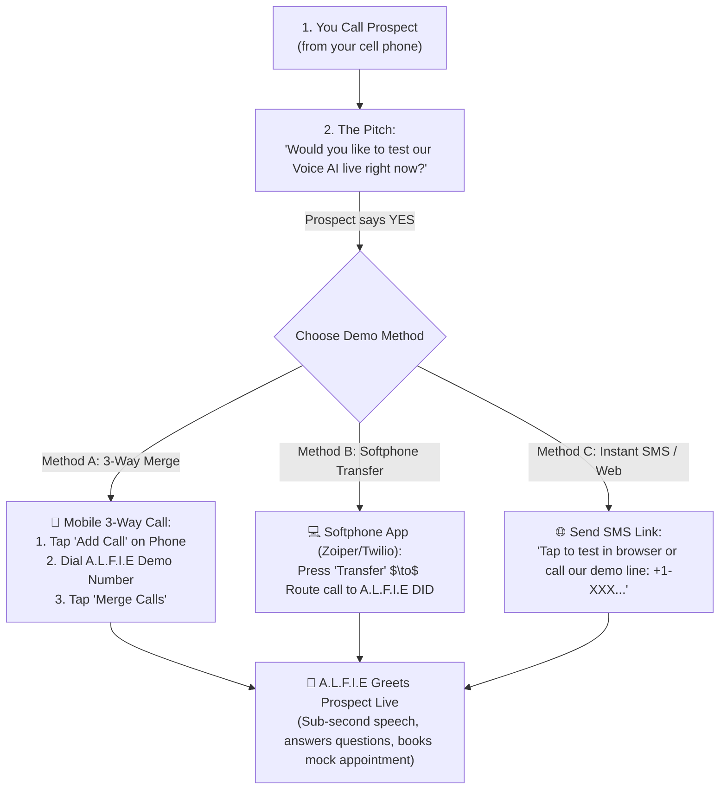

# A.L.F.I.E — Dedicated US Phone Number & Live Demo Transfer Guide

> **Purpose**: Complete guide on selecting, purchasing, and configuring a dedicated US phone number for A.L.F.I.E, and running live demo transfers during cold calls with prospective clients.

---

## 1. Provider Comparison & Recommendations

| Provider | Monthly Number Cost | Inbound Rate / Min | SIP Trunking & WebRTC | Best For |
| :--- | :--- | :--- | :--- | :--- |
| 🥇 **Telnyx** *(Recommended)* | **$1.00 / month** | **$0.0040 / min** (~$0.24 / hr) | ✅ Full Native SIP Trunking (G.711 / Opus) | **Best overall value, lowest per-minute cost, high-fidelity SIP routing.** |
| 🥈 **LiveKit Cloud Native DIDs** | Included / $1.00/mo | **$0.0050 / min** | ✅ Direct Zero-Config LiveKit Ingestion | **Fastest 1-click setup (no SIP trunk configuration needed).** |
| 🥉 **Twilio Elastic SIP** | **$1.15 / month** | **$0.0085 / min** (~$0.51 / hr) | ✅ Enterprise SIP Trunking | **Worldwide brand recognition and high carrier redundancy.** |
| ❌ **Google Voice** | Free (personal) / $10/mo | N/A | ❌ **No SIP Trunking Support** | **Not suitable:** Google Voice cannot route calls to AI engines, WebRTC media servers, or custom webhooks. |

---

## 2. Step-by-Step: Setting Up a Dedicated US Number with Telnyx

### Step 1: Create a Telnyx Account
1. Go to [Telnyx.com](https://telnyx.com) and sign up (you get $10 free trial credit).
2. Navigate to **Numbers** $\to$ **Search & Buy Numbers**.
3. Choose **United States (+1)**, select any state/city or toll-free (e.g., California `+1-415...` or Florida `+1-305...`), and purchase the number for **$1.00/mo**.

### Step 2: Create a SIP Trunk (Outbound/Inbound)
1. In the Telnyx Portal, navigate to **Voice** $\to$ **SIP Trunks**.
2. Click **Create SIP Trunk** $\to$ Name it `ALFIE-Voice-AI`.
3. Under **SIP URI**, enter your LiveKit Inbound SIP URI:
   ```
   sip:<YOUR_LIVEKIT_PROJECT_DOMAIN>.sip.livekit.cloud
   ```
4. Attach your newly purchased phone number to this SIP Trunk.

### Step 3: Map the Number in A.L.F.I.E Super Admin
1. Open your **Super Admin Portal** (`http://localhost:5173/phone-numbers`).
2. Click **+ Add Phone Number**.
3. Fill in:
   - **Phone Number:** `+1XXXXXXXXXX` (the Telnyx number you bought)
   - **Assigned Tenant:** `demo-tenant` (or select your target client)
   - **Niche / Persona:** `demo` (or `real_estate`, `car_rental`, etc.)
   - **Provider:** `Telnyx SIP`
4. Click **Save Number**.

Now, whenever anyone dials that US number, A.L.F.I.E answers on the first ring with the configured Demo AI persona!

---

## 3. Cold Calling Live Demo Playbook

When cold-calling a prospective client (e.g. Real Estate Agency, Luxury Car Rental, Law Firm, Clinic), use one of these three battle-tested live demo methods:



### Method A: Mobile Phone 3-Way Conference / Merge (Fastest & Zero Setup)
1. While talking to the prospect on your mobile phone:
2. Say: *"Let me bring our AI receptionist on the line right now so you can hear how natural it sounds."*
3. Tap **Add Call** on your phone screen.
4. Dial your A.L.F.I.E US Demo Number (`+1-XXX...`).
5. As soon as A.L.F.I.E answers, tap **Merge Calls**.
6. Introduce the AI: *"A.L.F.I.E, I have John on the line from Luxury Auto Rentals. Could you show him how you qualify callers and check car availability?"*
7. Let A.L.F.I.E take over the conversation and close the demonstration!

### Method B: Softphone Attended / Blind Transfer
If you use a VoIP softphone app on your laptop or phone (like **Zoiper**, **Groundwire**, or **Twilio WebRTC Client**):
1. Pitch the client on the live call.
2. Click the **Transfer** button in the softphone interface.
3. Enter your A.L.F.I.E US DID.
4. The call is cleanly handed over to A.L.F.I.E with carrier-grade audio quality.

### Method C: In-Browser Instant Voice Demo (Marketing Website)
If the client prefers to test from their computer or mobile browser:
1. Direct them to your marketing website hero section: `https://your-domain.com`.
2. They click **"Test A.L.F.I.E Voice AI Live"** and speak directly into their microphone without installing any apps or entering credit cards.

---

## 4. Testing Your Demo Setup

To test the demo agent locally or over WebRTC:
1. Ensure the backend is running:
   ```powershell
   cd backend
   .venv\Scripts\python.exe -m uvicorn api:app --reload --port 8000
   ```
2. Start the LiveKit Agent Worker:
   ```powershell
   cd backend
   .venv\Scripts\python.exe agent.py dev
   ```
3. Open the **Super Admin Simulator** (`http://localhost:5173/` $\to$ click **Launch Simulator**) or the **Public Demo Web Widget** on your marketing website to test conversational latency, vertical switching, and language fluencies.
