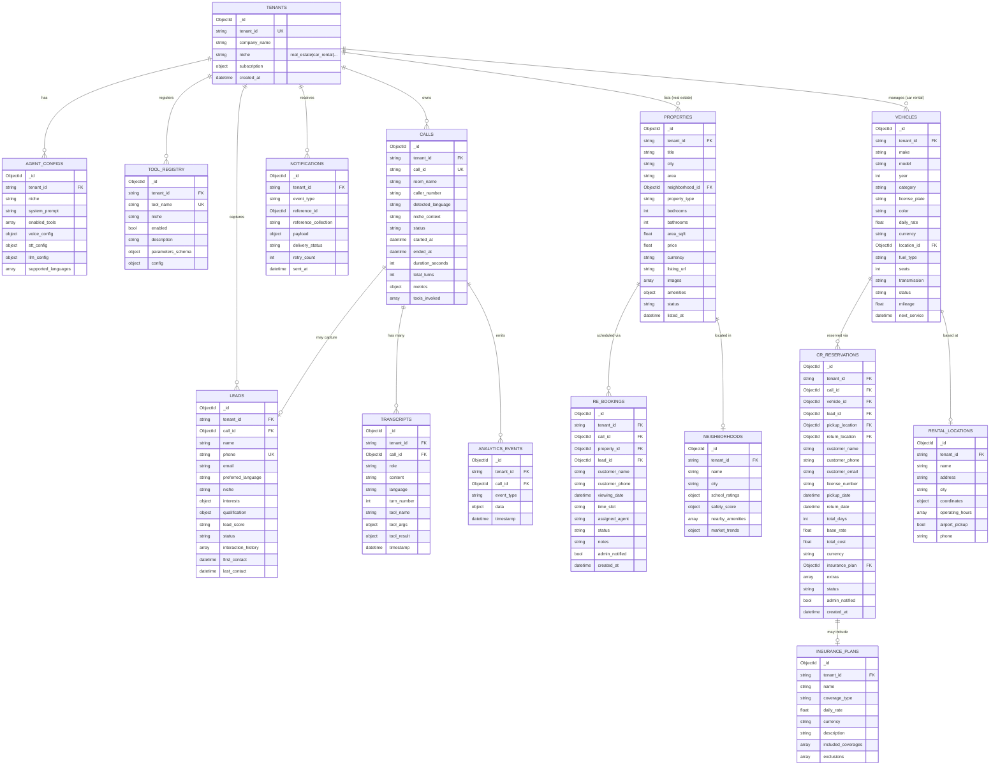
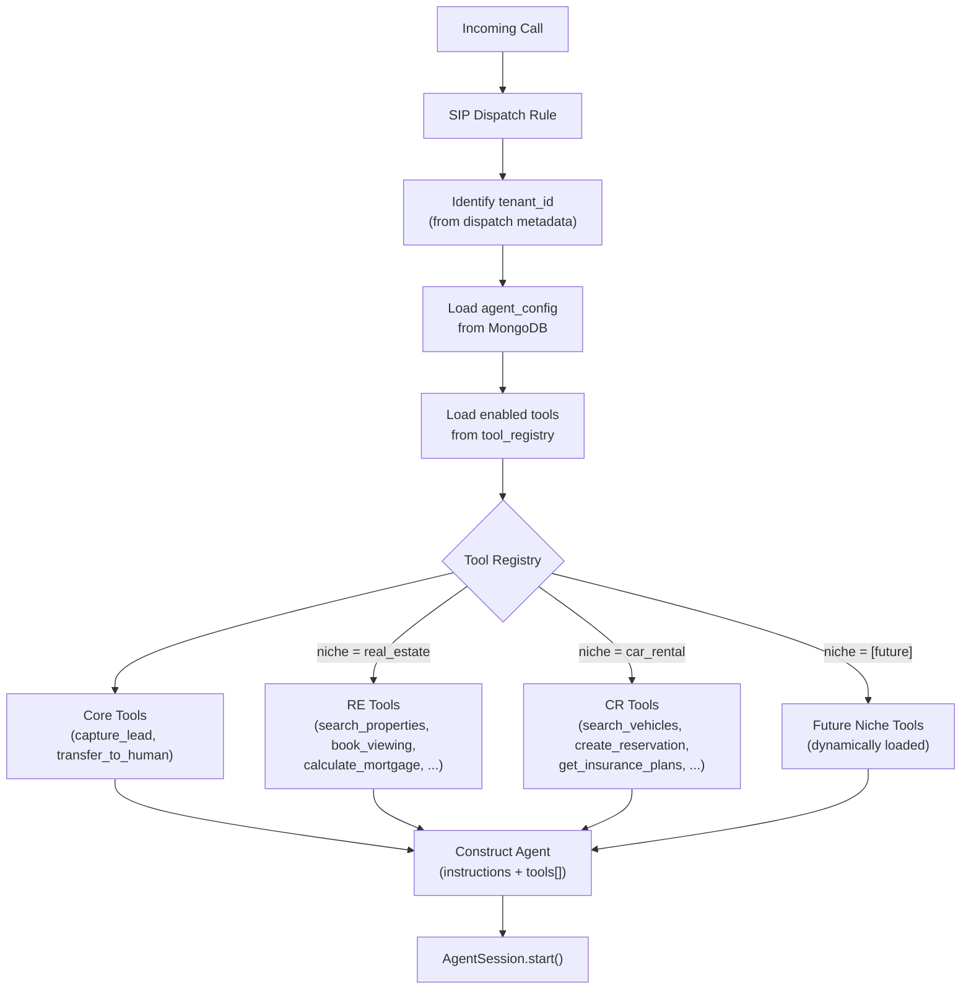

# A.L.F.I.E — Enhanced Data Model (Modular, Multi-Niche)

**Version**: 3.0 | **Date**: 2026-08-04

---

## 1. Design Philosophy: Niche-Agnostic Modularity

A.L.F.I.E is designed as a **multi-tenant, multi-niche platform**. The data model separates the **platform core** (calls, transcripts, tenants, metrics) from **niche-specific modules** (real estate, car rental, future verticals). This means:

- **Core collections** never change when adding a new niche
- **Niche modules** are self-contained — each has its own collections, tools, and prompts
- Every document carries a `tenant_id` — queries are always scoped to the client
- New niches can be added without touching existing code

```
┌──────────────────────────────────────────────────────┐
│                   PLATFORM CORE                       │
│  (niche-agnostic — never changes per vertical)       │
│                                                       │
│  ┌──────────┐ ┌─────────────┐ ┌──────────────────┐  │
│  │ tenants  │ │   calls     │ │  transcripts     │  │
│  └──────────┘ └─────────────┘ └──────────────────┘  │
│  ┌──────────┐ ┌─────────────┐ ┌──────────────────┐  │
│  │  leads   │ │ tool_registry│ │  notifications   │  │
│  └──────────┘ └─────────────┘ └──────────────────┘  │
│  ┌──────────────────┐ ┌──────────────────────────┐   │
│  │  agent_configs   │ │  analytics_events        │   │
│  └──────────────────┘ └──────────────────────────┘   │
├──────────────────────────────────────────────────────┤
│              NICHE MODULE: Real Estate                │
│  ┌──────────┐ ┌─────────────┐ ┌──────────────────┐  │
│  │properties│ │  bookings   │ │ neighborhoods    │  │
│  └──────────┘ └─────────────┘ └──────────────────┘  │
├──────────────────────────────────────────────────────┤
│              NICHE MODULE: Car Rental                 │
│  ┌──────────┐ ┌─────────────┐ ┌──────────────────┐  │
│  │ vehicles │ │reservations │ │ rental_locations │  │
│  └──────────┘ └─────────────┘ └──────────────────┘  │
│  ┌──────────────────┐                                │
│  │ insurance_plans  │                                │
│  └──────────────────┘                                │
├──────────────────────────────────────────────────────┤
│           NICHE MODULE: [Future Vertical]            │
│                  (plug in later)                      │
└──────────────────────────────────────────────────────┘
```

---

## 2. Entity Relationship Diagram — Full System



---

## 3. Platform Core Collections (Niche-Agnostic)

### 3.1 `tenants`

Each client company that uses A.L.F.I.E. Scopes ALL data access.

```json
{
  "_id": "ObjectId",
  "tenant_id": "alfie_realty_pk",
  "company_name": "Alfie Realty Pakistan",
  "niche": "real_estate",
  "contact_email": "admin@alfierealty.pk",
  "contact_phone": "+923001234567",
  "subscription": {
    "plan": "starter",
    "max_monthly_minutes": 500,
    "used_minutes": 142,
    "billing_cycle_start": "2026-08-01T00:00:00Z"
  },
  "webhook_urls": {
    "new_booking": "https://admin.alfierealty.pk/api/webhooks/booking",
    "new_lead": "https://admin.alfierealty.pk/api/webhooks/lead",
    "call_completed": null
  },
  "sip_config": {
    "phone_number": "+12025551234",
    "livekit_agent_name": "alfie-realty-pk",
    "dispatch_rule_id": "SDR_abc123"
  },
  "active": true,
  "created_at": "2026-07-01T00:00:00Z"
}
```

**Indexes**:
- `{ tenant_id: 1 }` — unique, primary lookup
- `{ niche: 1, active: 1 }` — list tenants by vertical

---

### 3.2 `agent_configs`

Per-tenant agent personality, voice, and pipeline configuration. This is what makes each client's agent unique.

```json
{
  "_id": "ObjectId",
  "tenant_id": "alfie_realty_pk",
  "niche": "real_estate",
  "agent_name": "Alfie",
  "system_prompt": "You are Alfie, a professional real estate assistant for Alfie Realty Pakistan...",
  "greeting_message": "Greet the caller warmly and ask how you can help with property search today.",
  "enabled_tools": [
    "search_properties", "get_property_details", "check_viewing_availability",
    "book_viewing", "calculate_mortgage", "get_neighborhood_info",
    "compare_properties", "capture_lead", "transfer_to_human"
  ],
  "voice_config": {
    "provider": "fish_audio",
    "model": "s2.1-pro",
    "voice_id": "<fish-audio-voice-id>",
    "latency_mode": "balanced"
  },
  "stt_config": {
    "provider": "deepgram",
    "model": "nova-3",
    "language": "multi",
    "keyterms": ["DHA", "Bahria Town", "PKR", "marla", "kanal"]
  },
  "llm_config": {
    "provider": "openrouter",
    "model": "meta-llama/llama-3.3-70b-instruct:free",
    "base_url": "https://openrouter.ai/api/v1",
    "temperature": 0.7,
    "max_tokens": 256
  },
  "vad_config": {
    "min_silence_duration": 0.6,
    "activation_threshold": 0.3
  },
  "supported_languages": ["en", "ur", "ar"],
  "business_hours": {
    "timezone": "Asia/Karachi",
    "schedule": {
      "mon-fri": { "start": "09:00", "end": "18:00" },
      "sat": { "start": "10:00", "end": "14:00" },
      "sun": null
    },
    "after_hours_message": "Our office is currently closed. I can still help you search properties and I'll have an agent call you back during business hours."
  },
  "escalation_rules": {
    "max_failed_tool_calls": 3,
    "escalation_phrases": ["speak to a human", "real person", "manager"],
    "transfer_number": "+923001234567"
  },
  "updated_at": "2026-08-04T00:00:00Z"
}
```

**Indexes**:
- `{ tenant_id: 1 }` — unique, one config per tenant

---

### 3.3 `tool_registry`

Dynamic tool registration per tenant. The agent loads only tools that are `enabled: true` for the active tenant.

```json
{
  "_id": "ObjectId",
  "tenant_id": "alfie_realty_pk",
  "tool_name": "search_properties",
  "niche": "real_estate",
  "enabled": true,
  "description": "Search real estate listings matching caller criteria like city, bedrooms, price range, and property type.",
  "parameters_schema": {
    "type": "object",
    "properties": {
      "city": { "type": "string", "description": "City name" },
      "area": { "type": "string", "description": "Specific area or neighborhood" },
      "bedrooms": { "type": "integer", "description": "Number of bedrooms" },
      "min_price": { "type": "number", "description": "Minimum price" },
      "max_price": { "type": "number", "description": "Maximum price" },
      "property_type": { "type": "string", "enum": ["house", "apartment", "plot", "commercial"] }
    },
    "required": ["city"]
  },
  "config": {
    "max_results": 3,
    "sort_by": "price",
    "include_neighborhood_data": true
  },
  "filler_phrases": {
    "en": "Let me search our listings for you.",
    "ur": "میں آپ کے لیے لسٹنگز تلاش کرتا ہوں۔",
    "ar": "دعني أبحث في القوائم المتاحة."
  },
  "created_at": "2026-08-01T00:00:00Z"
}
```

**Indexes**:
- `{ tenant_id: 1, tool_name: 1 }` — unique compound
- `{ niche: 1, enabled: 1 }` — list tools by vertical

---

### 3.4 `calls`

Every inbound/outbound call session. Niche-agnostic — works for any vertical.

```json
{
  "_id": "ObjectId",
  "tenant_id": "alfie_realty_pk",
  "call_id": "alfie-call-f7a2b9c1",
  "room_name": "alfie-call-f7a2b9c1",
  "direction": "inbound",
  "caller_number": "+12025550123",
  "detected_language": "ur",
  "niche_context": "real_estate",
  "status": "completed",
  "disposition": "lead_qualified",
  "started_at": "2026-08-04T17:00:00Z",
  "ended_at": "2026-08-04T17:04:32Z",
  "duration_seconds": 272,
  "total_turns": 14,
  "tools_invoked": [
    { "tool": "search_properties", "count": 2, "avg_latency_ms": 340 },
    { "tool": "book_viewing", "count": 1, "avg_latency_ms": 520 },
    { "tool": "capture_lead", "count": 1, "avg_latency_ms": 180 }
  ],
  "metrics": {
    "avg_stt_latency_ms": 180,
    "avg_llm_ttft_ms": 420,
    "avg_tts_ttfa_ms": 290,
    "total_llm_tokens": 2840,
    "interruptions_count": 3,
    "context_prunes_count": 0
  },
  "sentiment": "positive",
  "summary": "Caller looking for 3BR house in Metro Area, budget $1.5M-$2M. Booked viewing for tomorrow 2PM. Lead captured.",
  "tags": ["qualified", "booking_made", "high_intent"]
}
```

**Indexes**:
- `{ tenant_id: 1, status: 1, started_at: -1 }` — tenant-scoped call history
- `{ tenant_id: 1, caller_number: 1 }` — repeat caller lookup
- `{ tenant_id: 1, disposition: 1 }` — filter by outcome

**Call dispositions** (niche-agnostic):
| Disposition | Meaning |
|:------------|:--------|
| `lead_qualified` | Caller intent confirmed, data captured |
| `booking_made` | Appointment/reservation created |
| `info_only` | General inquiry, no commitment |
| `transferred` | Escalated to human agent |
| `dropped` | Call disconnected unexpectedly |
| `after_hours` | Voicemail or callback scheduled |
| `repeat_caller` | Returning caller, matched to existing lead |

---

### 3.5 `transcripts`

Full conversation history with tool call tracing. One document per turn.

```json
{
  "_id": "ObjectId",
  "tenant_id": "alfie_realty_pk",
  "call_id": "ObjectId → calls._id",
  "role": "assistant",
  "content": "I found two great options in DHA Phase 2. The first is a three bedroom house for thirty five million rupees with a garden and two car parking.",
  "language": "en",
  "turn_number": 5,
  "tool_name": null,
  "tool_args": null,
  "tool_result": null,
  "timestamp": "2026-08-04T17:01:45Z"
}
```

```json
{
  "_id": "ObjectId",
  "tenant_id": "alfie_realty_pk",
  "call_id": "ObjectId → calls._id",
  "role": "tool",
  "content": null,
  "language": null,
  "turn_number": 4,
  "tool_name": "search_properties",
  "tool_args": { "city": "Islamabad", "area": "DHA Phase 2", "bedrooms": 3 },
  "tool_result": {
    "count": 2,
    "properties": [
      { "id": "...", "title": "3BR House DHA Ph2", "price": 35000000 },
      { "id": "...", "title": "3BR House DHA Ph2 St 15", "price": 38000000 }
    ]
  },
  "timestamp": "2026-08-04T17:01:42Z"
}
```

**Indexes**:
- `{ tenant_id: 1, call_id: 1, turn_number: 1 }` — reconstruct conversation
- `{ tenant_id: 1, tool_name: 1, timestamp: -1 }` — tool usage analytics

---

### 3.6 `leads`

Unified lead management across all niches. The `interests` object is niche-flexible.

```json
{
  "_id": "ObjectId",
  "tenant_id": "alfie_realty_pk",
  "call_id": "ObjectId → calls._id (first contact)",
  "name": "Alex Mercer",
  "phone": "+12025550123",
  "email": "alex.mercer@example.com",
  "preferred_language": "ur",
  "niche": "real_estate",
  "interests": {
    "search_criteria": {
      "city": "Islamabad",
      "areas": ["DHA Phase 2", "DHA Phase 5"],
      "bedrooms": 3,
      "min_price": 30000000,
      "max_price": 45000000,
      "property_type": "house"
    },
    "notes": "Relocating from out of state, needs possession within 2 months"
  },
  "qualification": {
    "budget_confirmed": true,
    "timeline": "immediate",
    "financing": "pre_approved",
    "decision_maker": true,
    "motivation": "relocation"
  },
  "lead_score": "hot",
  "status": "active",
  "assigned_agent": "Bilal (Senior Agent)",
  "interaction_history": [
    {
      "call_id": "ObjectId",
      "date": "2026-08-04T17:00:00Z",
      "summary": "Searched DHA properties, booked viewing",
      "outcome": "booking_made"
    }
  ],
  "follow_up": {
    "next_action": "confirm_viewing",
    "scheduled_at": "2026-08-05T09:00:00Z",
    "channel": "phone"
  },
  "source": "inbound_call",
  "first_contact": "2026-08-04T17:00:00Z",
  "last_contact": "2026-08-04T17:04:32Z"
}
```

**Indexes**:
- `{ tenant_id: 1, phone: 1 }` — unique compound (upsert on repeat callers)
- `{ tenant_id: 1, lead_score: 1, status: 1 }` — prioritize hot leads
- `{ tenant_id: 1, "follow_up.scheduled_at": 1 }` — follow-up queue

**Lead scoring** (niche-agnostic):
| Score | Criteria |
|:------|:---------|
| `hot` | Budget confirmed + immediate timeline + viewing booked |
| `warm` | Expressed interest + shared contact info |
| `cold` | General inquiry only, no commitment signals |
| `dormant` | No interaction in 30+ days |

---

### 3.7 `notifications`

Webhook delivery tracking. Retryable, auditable.

```json
{
  "_id": "ObjectId",
  "tenant_id": "alfie_realty_pk",
  "event_type": "new_booking",
  "reference_id": "ObjectId → bookings._id",
  "reference_collection": "re_bookings",
  "webhook_url": "https://admin.alfierealty.pk/api/webhooks/booking",
  "payload": { "...full webhook payload..." },
  "delivery_status": "delivered",
  "http_status_code": 200,
  "retry_count": 0,
  "max_retries": 3,
  "sent_at": "2026-08-04T17:03:01Z",
  "delivered_at": "2026-08-04T17:03:01Z"
}
```

**Indexes**:
- `{ tenant_id: 1, delivery_status: 1 }` — retry failed notifications
- `{ tenant_id: 1, event_type: 1, sent_at: -1 }` — notification history

---

### 3.8 `analytics_events`

Granular event stream for dashboards and reporting.

```json
{
  "_id": "ObjectId",
  "tenant_id": "alfie_realty_pk",
  "call_id": "ObjectId",
  "event_type": "tool_executed",
  "data": {
    "tool_name": "search_properties",
    "latency_ms": 340,
    "results_count": 2,
    "success": true
  },
  "timestamp": "2026-08-04T17:01:42Z"
}
```

**Event types**: `call_started`, `call_ended`, `language_detected`, `tool_executed`, `tool_failed`, `lead_captured`, `booking_created`, `interruption`, `context_pruned`, `escalation_triggered`

**Indexes**:
- `{ tenant_id: 1, event_type: 1, timestamp: -1 }` — filtered event queries
- TTL index: `{ timestamp: 1 }, expireAfterSeconds: 7776000` — auto-delete after 90 days

---

## 4. Niche Module: Real Estate

### 4.1 `properties`

```json
{
  "_id": "ObjectId",
  "tenant_id": "alfie_realty_pk",
  "title": "3 Bedroom House in DHA Phase 2 Islamabad",
  "description": "Modern 3-bedroom house with 10 marla plot, imported kitchen, lawn, servant quarter, 2 car parking.",
  "city": "Islamabad",
  "area": "DHA Phase 2",
  "neighborhood_id": "ObjectId → neighborhoods._id",
  "property_type": "house",
  "bedrooms": 3,
  "bathrooms": 2,
  "area_sqft": 2250,
  "area_marla": 10,
  "price": 35000000,
  "currency": "PKR",
  "price_per_sqft": 15556,
  "listing_url": "https://alfierealty.pk/property/dha-ph2-3br-001",
  "images": [
    "https://cdn.alfierealty.pk/img/dha-ph2-3br-001-front.jpg",
    "https://cdn.alfierealty.pk/img/dha-ph2-3br-001-kitchen.jpg"
  ],
  "amenities": {
    "parking": 2,
    "garden": true,
    "servant_quarter": true,
    "central_heating": false,
    "security": "gated_community",
    "gas": true,
    "electricity_backup": "generator"
  },
  "floor_plan_url": null,
  "virtual_tour_url": null,
  "status": "available",
  "featured": true,
  "comparable_properties": ["ObjectId", "ObjectId"],
  "agent_notes": "Owner motivated, price slightly negotiable",
  "listed_at": "2026-07-15T00:00:00Z",
  "updated_at": "2026-08-01T00:00:00Z"
}
```

**Indexes**:
- `{ tenant_id: 1, city: 1, bedrooms: 1, price: 1 }` — primary search
- `{ tenant_id: 1, area: 1, property_type: 1, status: 1 }` — filtered browse
- `{ tenant_id: 1, status: 1, featured: -1, listed_at: -1 }` — featured first
- Text: `{ title: "text", description: "text", area: "text" }` — free-text search

---

### 4.2 `neighborhoods`

Area intelligence the agent can reference during calls.

```json
{
  "_id": "ObjectId",
  "tenant_id": "alfie_realty_pk",
  "name": "DHA Phase 2",
  "city": "Islamabad",
  "description": "Premium residential area with excellent security, wide roads, and proximity to commercial hubs.",
  "school_ratings": {
    "nearby_schools": [
      { "name": "Beaconhouse DHA Campus", "rating": 4.5, "type": "private", "distance_km": 1.2 },
      { "name": "Roots Millennium", "rating": 4.3, "type": "private", "distance_km": 2.1 }
    ],
    "avg_rating": 4.4
  },
  "safety_score": {
    "overall": 9.2,
    "gated": true,
    "security_patrols": true,
    "cctv_coverage": true
  },
  "nearby_amenities": [
    { "type": "hospital", "name": "Shifa International", "distance_km": 3.5 },
    { "type": "shopping", "name": "Centaurus Mall", "distance_km": 8.0 },
    { "type": "mosque", "name": "DHA Jamia Masjid", "distance_km": 0.5 },
    { "type": "park", "name": "DHA Sports Complex", "distance_km": 1.0 }
  ],
  "market_trends": {
    "avg_price_per_marla": 4500000,
    "price_change_yoy": "+12%",
    "avg_days_on_market": 45,
    "demand_level": "high"
  },
  "commute_times": {
    "to_blue_area": "25 min",
    "to_airport": "15 min",
    "to_motorway": "10 min"
  },
  "updated_at": "2026-08-01T00:00:00Z"
}
```

**Indexes**:
- `{ tenant_id: 1, city: 1, name: 1 }` — unique compound

---

### 4.3 `re_bookings` (Real Estate Bookings)

```json
{
  "_id": "ObjectId",
  "tenant_id": "alfie_realty_pk",
  "call_id": "ObjectId → calls._id",
  "property_id": "ObjectId → properties._id",
  "lead_id": "ObjectId → leads._id",
  "customer_name": "Alex Mercer",
  "customer_phone": "+12025550123",
  "customer_email": "alex.mercer@example.com",
  "viewing_date": "2026-08-05T00:00:00Z",
  "time_slot": "2:00 PM - 2:30 PM",
  "assigned_agent": "Jordan Reed",
  "agent_phone": "+12025550199",
  "status": "scheduled",
  "type": "in_person",
  "notes": "Caller relocating from out of state, interested in possession timeline",
  "reminder_sent": false,
  "feedback": null,
  "admin_notified": true,
  "notification_id": "ObjectId → notifications._id",
  "created_at": "2026-08-04T17:03:00Z",
  "updated_at": "2026-08-04T17:03:00Z"
}
```

**Indexes**:
- `{ tenant_id: 1, property_id: 1, viewing_date: 1 }` — slot availability
- `{ tenant_id: 1, status: 1, viewing_date: 1 }` — upcoming schedule
- `{ tenant_id: 1, assigned_agent: 1, viewing_date: 1 }` — agent calendar

---

### 4.4 Real Estate Tool Catalog

| # | Tool | Description | Key Parameters |
|:--|:-----|:------------|:---------------|
| 1 | `search_properties` | Search listings by criteria | city, area, bedrooms, price range, type |
| 2 | `get_property_details` | Full listing with images/amenities | property_id |
| 3 | `compare_properties` | Side-by-side comparison of 2-3 properties | property_ids[] |
| 4 | `get_neighborhood_info` | School ratings, safety, amenities, market trends | neighborhood_name, city |
| 5 | `check_viewing_availability` | Available time slots | property_id, date |
| 6 | `book_viewing` | Schedule appointment + notify admin | property_id, date, time, customer details |
| 7 | `calculate_mortgage` | Monthly payment estimate | price, down_payment%, term, interest_rate |
| 8 | `get_market_trends` | Price trends, avg days on market for an area | city, area |
| 9 | `capture_lead` | Save caller info + preferences | name, phone, email, interests |
| 10 | `schedule_callback` | Book a callback from human agent | preferred_time, reason |
| 11 | `transfer_to_human` | Live transfer to human agent | reason |

---

## 5. Niche Module: Car Rental

### 5.1 `vehicles`

```json
{
  "_id": "ObjectId",
  "tenant_id": "alfie_rentals_pk",
  "make": "Toyota",
  "model": "Corolla",
  "year": 2025,
  "variant": "GLi 1.3",
  "category": "sedan",
  "license_plate": "ISB-1234",
  "color": "White",
  "daily_rate": 5500,
  "weekly_rate": 33000,
  "monthly_rate": 120000,
  "currency": "PKR",
  "location_id": "ObjectId → rental_locations._id",
  "fuel_type": "petrol",
  "fuel_policy": "full_to_full",
  "seats": 5,
  "transmission": "automatic",
  "engine_cc": 1300,
  "features": ["AC", "power_steering", "airbags", "bluetooth", "rear_camera"],
  "images": ["https://cdn.alfierentals.pk/img/corolla-white-001.jpg"],
  "status": "available",
  "mileage_km": 23400,
  "mileage_limit_daily": 250,
  "excess_mileage_rate": 15,
  "next_service_date": "2026-09-01T00:00:00Z",
  "min_driver_age": 21,
  "required_documents": ["national_id", "driving_license"],
  "deposit_amount": 15000,
  "created_at": "2026-06-01T00:00:00Z"
}
```

**Indexes**:
- `{ tenant_id: 1, category: 1, status: 1, daily_rate: 1 }` — search by type+price
- `{ tenant_id: 1, location_id: 1, status: 1 }` — vehicles at location
- `{ tenant_id: 1, make: 1, model: 1 }` — specific vehicle search

---

### 5.2 `rental_locations`

```json
{
  "_id": "ObjectId",
  "tenant_id": "alfie_rentals_pk",
  "name": "Islamabad Airport Branch",
  "code": "ISB-APT",
  "address": "Islamabad International Airport, Terminal 1, Arrivals",
  "city": "Islamabad",
  "coordinates": { "lat": 33.5495, "lng": 72.8347 },
  "operating_hours": {
    "mon-sun": { "start": "06:00", "end": "23:00" }
  },
  "airport_pickup": true,
  "after_hours_dropoff": true,
  "phone": "+925112345678",
  "available_categories": ["economy", "sedan", "suv", "luxury", "van"],
  "active": true
}
```

---

### 5.3 `cr_reservations` (Car Rental Reservations)

```json
{
  "_id": "ObjectId",
  "tenant_id": "alfie_rentals_pk",
  "call_id": "ObjectId → calls._id",
  "vehicle_id": "ObjectId → vehicles._id",
  "lead_id": "ObjectId → leads._id",
  "confirmation_number": "AR-2026-08-001",
  "customer_name": "Sara Ahmed",
  "customer_phone": "+12025550123",
  "customer_email": "sara@email.com",
  "license_number": "ISB-DL-12345",
  "driver_age": 28,
  "pickup_location": "ObjectId → rental_locations._id",
  "return_location": "ObjectId → rental_locations._id",
  "pickup_date": "2026-08-10T10:00:00Z",
  "return_date": "2026-08-14T10:00:00Z",
  "total_days": 4,
  "base_rate": 5500,
  "total_base_cost": 22000,
  "insurance_plan_id": "ObjectId → insurance_plans._id",
  "insurance_cost": 3200,
  "extras": [
    { "name": "GPS Navigator", "daily_rate": 500, "total": 2000 },
    { "name": "Child Seat", "daily_rate": 300, "total": 1200 }
  ],
  "extras_total": 3200,
  "discount_applied": null,
  "total_cost": 28400,
  "deposit_amount": 15000,
  "currency": "PKR",
  "payment_status": "deposit_pending",
  "status": "confirmed",
  "admin_notified": true,
  "special_requests": "Airport pickup at arrivals gate",
  "created_at": "2026-08-04T17:05:00Z"
}
```

**Indexes**:
- `{ tenant_id: 1, vehicle_id: 1, pickup_date: 1, return_date: 1 }` — availability check
- `{ tenant_id: 1, status: 1, pickup_date: 1 }` — upcoming rentals
- `{ tenant_id: 1, confirmation_number: 1 }` — reservation lookup

---

### 5.4 `insurance_plans`

```json
{
  "_id": "ObjectId",
  "tenant_id": "alfie_rentals_pk",
  "name": "Comprehensive Coverage",
  "coverage_type": "full",
  "daily_rate": 800,
  "currency": "PKR",
  "description": "Full coverage including collision, theft, third-party liability, and roadside assistance.",
  "included_coverages": [
    "collision_damage_waiver",
    "theft_protection",
    "third_party_liability",
    "roadside_assistance",
    "personal_accident"
  ],
  "exclusions": [
    "tire_damage",
    "undercarriage_damage",
    "driving_under_influence"
  ],
  "deductible": 5000,
  "active": true
}
```

---

### 5.5 Car Rental Tool Catalog

| # | Tool | Description | Key Parameters |
|:--|:-----|:------------|:---------------|
| 1 | `search_vehicles` | Find available cars by category, dates, location | category, pickup_date, return_date, location, budget |
| 2 | `get_vehicle_details` | Full vehicle specs and photos | vehicle_id |
| 3 | `check_availability` | Verify a specific vehicle for requested dates | vehicle_id, pickup_date, return_date |
| 4 | `get_rental_quote` | Calculate total cost with insurance + extras | vehicle_id, dates, insurance_plan, extras[] |
| 5 | `create_reservation` | Book a vehicle + notify admin | vehicle_id, dates, locations, customer details |
| 6 | `modify_reservation` | Change dates, vehicle, or location | reservation_id, changes |
| 7 | `cancel_reservation` | Cancel with policy-aware messaging | reservation_id, reason |
| 8 | `get_insurance_plans` | List available protection plans | vehicle_category |
| 9 | `get_locations` | List pickup/return locations | city, airport_only |
| 10 | `check_driver_requirements` | Verify age, license, documents needed | driver_age, nationality |
| 11 | `report_issue` | Log roadside/damage issue during rental | reservation_id, issue_type, description |
| 12 | `extend_rental` | Extend return date for active rental | reservation_id, new_return_date |
| 13 | `get_loyalty_status` | Check points, tier, available rewards | customer_phone |
| 14 | `capture_lead` | Save caller details (shared with core) | name, phone, email, interests |
| 15 | `transfer_to_human` | Escalate to human (shared with core) | reason |

---

## 6. Modular Tool Loading Architecture



### How It Works at Runtime

```python
# 1. Identify tenant from SIP dispatch metadata
tenant_id = ctx.room.metadata.get("tenant_id")

# 2. Load tenant config from MongoDB
config = await db.agent_configs.find_one({"tenant_id": tenant_id})

# 3. Load enabled tools from registry
tool_docs = await db.tool_registry.find({
    "tenant_id": tenant_id,
    "enabled": True
}).to_list()

# 4. Map tool names to implementations
active_tools = [TOOL_IMPLEMENTATIONS[t["tool_name"]] for t in tool_docs]

# 5. Construct agent with tenant-specific prompt + tools
agent = Agent(
    instructions=config["system_prompt"],
    tools=active_tools,
)
```

---

## 7. Adding a New Niche — Checklist

When onboarding a new industry vertical (e.g., healthcare, hospitality, legal):

- [ ] **Define collections**: Create niche-specific collections (e.g., `appointments`, `patients`, `doctors`)
- [ ] **Define tools**: Write `@function_tool` implementations for the niche
- [ ] **Seed tool_registry**: Insert tool definitions with `parameters_schema` for the new niche
- [ ] **Write system prompt**: Create niche-specific prompt in `prompts/` directory
- [ ] **Create agent_config**: Insert a tenant config with the new niche's tools + prompt
- [ ] **Seed sample data**: Populate niche collections with demo data
- [ ] **Test end-to-end**: Verify tool calling, DB reads/writes, and webhook notifications

**No changes needed to**: `calls`, `transcripts`, `leads`, `notifications`, `analytics_events`, `agent.py` pipeline, Docker setup, or deployment.
