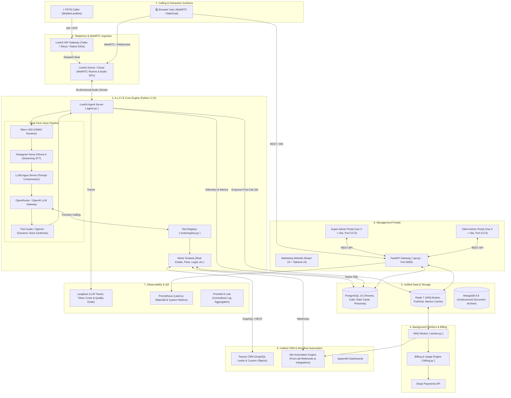
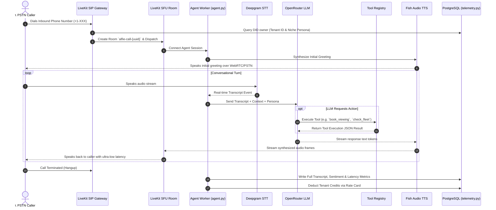

# A.L.F.I.E — Tech Stack, Tooling & Architecture Guide

> **Platform**: A.L.F.I.E (Automated Listening and Fluency Intelligence Engine)
> **Type**: Multi-Tenant, Multi-Niche, Multilingual Autonomous Voice AI Telephony & Conversational Platform  
> **Status**: Production Architecture

---

## 1. System Overview

A.L.F.I.E is an enterprise-grade, multi-tenant Voice AI platform designed for high-throughput telephony and web interactions. It empowers businesses across multiple verticals (Real Estate, Car Rental, Legal, Medical, Luxury Transport, Hospitality) with autonomous voice agents capable of handling inbound/outbound calls, performing real-time CRM updates, scheduling appointments, executing dynamic webhooks, and routing calls.



---

## 2. Technology Stack & Component Catalog

### A. Voice Telephony & Speech AI

| Tool / Platform | Package / Version | Purpose in A.L.F.I.E | How It Connects |
| :--- | :--- | :--- | :--- |
| **LiveKit Agents SDK** | `livekit-agents >= 1.6.0` | Powers real-time agent lifecycle, room subscription, worker dispatching, voice pipeline orchestration, and tool execution. | Connects directly to LiveKit Server/Cloud over WebRTC; orchestrates STT $\to$ LLM $\to$ TTS stream loops. |
| **LiveKit Server / Cloud** | WebRTC SFU | Manages media rooms, WebRTC audio/video transport, token authentication, and SIP bridge rooms. | Connects caller (SIP or Web) to agent worker containers. |
| **LiveKit SIP Gateway** | LiveKit SIP | Inbound DID number termination and outbound telephony dialing over PSTN (Twilio / Telnyx / native carriers). | Maps caller DID to tenant in `alfie_phone_numbers` and dispatches agent worker. |
| **Silero VAD** | `livekit-plugins-silero` (ONNX) | Low-latency Voice Activity Detection (VAD) to identify human speech start/end and manage turn-taking interruptions. | Embedded inside the agent worker voice pipeline via `onnxruntime`. |
| **Deepgram Nova-2 / Nova-3** | `livekit-plugins-deepgram` | Streaming Speech-to-Text (STT) transcription with multilingual support (English, Urdu, Arabic). | Consumes real-time audio frames from LiveKit room over secure WebSockets. |
| **OpenRouter LLM Gateway** | `livekit-plugins-openai` / OpenAI API | Unified LLM routing to Llama 3.3 70B, Claude 3.5 Sonnet, GPT-4o, and Qwen 2.5 72B. | Receives transcript text, evaluates system persona + active tools, and streams response tokens. |
| **Fish Audio** | `livekit-plugins-fishaudio` / REST API | Ultra-realistic, emotive Text-to-Speech (TTS) voice generation with dynamic Voice ID discovery and cloning. | Streams LLM text tokens into synthesized PCM audio frames pushed back to LiveKit room. |
| **LLMLingua Server** | `llmlingua`, `transformers`, `torch` | Microservice (`llmlingua_server.py`, Port 5000) that compresses long prompt contexts to lower token costs and reduce Time-to-First-Token (TTFT). | Invoked over HTTP prior to invoking heavy LLM reasoning chains. |

---

### B. Backend Application & Async Queue

| Tool / Package | Version | Purpose in A.L.F.I.E | How It Connects |
| :--- | :--- | :--- | :--- |
| **FastAPI** | `fastapi >= 0.103.0` | Core REST API (`api.py`) exposing Super Admin endpoints, Client Admin portals, WebChat sessions, and telemetry feeds. | Runs on Uvicorn; interfaces directly with PostgreSQL and Redis. |
| **AsyncPG** | `asyncpg >= 0.29.0` | High-performance asynchronous PostgreSQL database driver and connection pool (`telemetry.py`). | Manages database connection pool for sub-millisecond query execution. |
| **ARQ** | `arq >= 0.25.0` | Async Redis task queue (`worker.py`) for decoupled background operations (billing sweep, CRM syncing, n8n webhook triggers). | Reads jobs enqueued in Redis by `api.py` and `agent.py`. |
| **Redis** | `redis >= 5.0.0` / Redis 7 Alpine | In-memory message broker, task queue storage for ARQ, debug log streaming buffer, and rate limiter. | Shared across `api.py`, `agent.py`, `worker.py`, and Twenty CRM. |
| **Pydantic & Settings** | `pydantic >= 2.9.0`, `pydantic-settings` | Strongly-typed data validation, configuration parsing (`config.py`), and dynamic secret loading from `.env` / Docker secrets. | Validates all API schemas, database models, and environment variables. |
| **PyJWT & Passlib** | `PyJWT >= 2.8.0`, `passlib[bcrypt]` | Multi-tenant token authentication and secure Bcrypt password hashing for Super Admins and Client Admins. | Used in `auth.py` and route dependencies to secure endpoints. |
| **Stripe** | `stripe >= 10.12.0` | Automated billing, wallet top-ups, rate-card credit deductions, and voucher code redemptions (`billing.py`). | Handles checkout sessions and programmatic balance deductions per call. |

---

### C. Database & CRM Automation Layer

| Tool / Platform | Image / Technology | Purpose in A.L.F.I.E | How It Connects |
| :--- | :--- | :--- | :--- |
| **PostgreSQL 15** | `postgres:15-alpine` | Central relational database storing all platform entities: tenants, personas, DIDs, call recordings, rate cards, and niche tables. | Holds `twenty_db`, `n8n_db`, `appsmith_db`, and all `alfie_*` core platform tables. |
| **MongoDB 8.0** | `mongo:8.0` | Unstructured document store for raw call transcripts, deep payload logs, and legacy data backups. | Accessed asynchronously via motor/pymongo when deep document storage is requested. |
| **Twenty CRM** | `twentycrm/twenty:latest` | Open-source CRM providing lead management, contact pipelines, and custom business objects (Properties, Vehicles). | Connected to `twenty_db`; queried by A.L.F.I.E agents via GraphQL API (`crm_client.py`). |
| **n8n Automation Engine** | `n8nio/n8n:latest` | Low-code workflow automation orchestrator for external SMS/Email notifications, Google Sheets sync, and third-party webhooks. | Triggered via webhooks from ARQ worker post-call processor (`n8n-blueprints/`). |
| **Appsmith** | `appsmith/appsmith-ce` | Low-code custom dashboard builder for domain-specific operational views (e.g. interactive property maps, fleet Gantt charts). | Connects to `twenty_db` and `appsmith_db` over Postgres JDBC. |

---

### D. Observability, Telemetry & QA

| Tool / Platform | Package / Technology | Purpose in A.L.F.I.E | How It Connects |
| :--- | :--- | :--- | :--- |
| **Langfuse** | `langfuse >= 2.0.0` | Full LLM observability, prompt version tracking, exact token usage breakdown, and automated LLM-as-a-judge quality scoring. | Wrapped around LLM calls inside `telemetry.py` and `agent.py`. |
| **Prometheus** | `prometheus-fastapi-instrumentator` | System health tracking and real-time audio latency waterfall monitoring (STT delay, LLM TTFT, TTS latency, Total roundtrip). | Scrapes `/metrics` endpoint on FastAPI and agent workers. |
| **Promtail & Loki** | Grafana Loki Stack | Distributed log collection, log rotation, and real-time streaming to the admin debug console. | Tails Docker container logs and feeds them into the Super Admin WebSocket debugger (`DebugLogs.vue`). |

---

### E. Frontend Applications & Portals

| Application | Directory | Tech Stack | Purpose |
| :--- | :--- | :--- | :--- |
| **Super Admin Portal** | [`super_admin_ui/`](file:///d:/Projects/A.L.F.I.E/super_admin_ui) | Vue 3, Vite 8, Tailwind CSS, Pinia, Vue Router, Chart.js (Port 5173) | Full SaaS administrative control: tenant provisioning, custom rate card pricing, SIP DID mapping, Persona prompt engineering, Fish Audio voice selector, and real-time latency waterfall inspections. |
| **Client Admin Portal** | [`client_admin_ui/`](file:///d:/Projects/A.L.F.I.E/client_admin_ui) | Vue 3, Vite 8, Tailwind CSS, Pinia, Vue Router, Chart.js (Port 5174) | Tenant self-service dashboard: agent roster, live lead Kanban boards, customer call histories, audio playback, credit wallet balance, and embeddable WebChat widget. |
| **Marketing Website** | [`alfie_website/`](file:///d:/Projects/A.L.F.I.E/alfie_website) | React 19, Vite 8, Tailwind CSS v4, PostCSS, Oxlint | Public-facing marketing and landing page highlighting features, demo bookings, interactive ROI calculators, and pricing tiers. |
| **In-Browser Simulator** | `SimulatorModal.vue` | WebRTC LiveKit Client SDK | Embedded microphone playground in Super Admin UI enabling instant voice testing of agents without dialing a physical phone. |

---

## 3. Toolset & Modular Niche Architecture

A.L.F.I.E dynamically instantiates toolsets at runtime based on the tenant's vertical and configured tool toggles via [`tools/registry.py`](file:///d:/Projects/A.L.F.I.E/tools/registry.py):

```
tools/
├── registry.py           # Central ToolRegistry: maps tenant config -> LiveKit Toolsets
├── core.py               # Core tools: Call transfer, escalation, agent-to-agent routing
├── real_estate.py        # Real Estate: Property search, scheduling viewings, budget match
├── car_rental.py         # Car Rental: Fleet availability, vehicle reservation, pricing
├── calendar.py           # Cal.com & Google Calendar booking integrations
├── luxury_transport.py   # Chauffeur/limo bookings, flight tracking, route dispatch
├── legal.py              # Legal intake: Case qualification, conflict check, consultation
├── medical.py            # Medical clinic: Doctor appointments, insurance check, triage
└── hospitality.py        # Hotel concierge: Room service, table booking, amenities
```

---

## 4. End-to-End Execution Workflows

### Workflow 1: Inbound PSTN Voice Call Lifecycle



---

### Workflow 2: Post-Call Processing & CRM Automation

```mermaid
sequenceDiagram
    autonumber
    participant Agent as Agent Worker
    participant Redis as Redis Queue
    participant Worker as ARQ Worker (worker.py)
    participant Twenty as Twenty CRM (GraphQL)
    participant N8N as n8n Webhook Pipeline
    participant Stripe as Stripe Billing

    Agent->>Redis: Enqueue `process_post_call` Job with Call Summary
    Redis->>Worker: Dequeue Job
    Worker->>Twenty: Upsert Contact & Create Lead with Transcript Summary
    Worker->>N8N: Trigger Post-Call Webhook (SMS confirmation / Email notification)
    Worker->>Stripe: Audit usage vs balance; trigger auto-topup if below threshold
    Worker-->>Redis: Mark Job Completed
```

---

## 5. Directory & Repository Layout

```
A.L.F.I.E/
├── agent.py                     # Main LiveKit Voice Agent Worker entrypoint
├── api.py                       # FastAPI application (Super Admin & Client Admin endpoints)
├── auth.py                      # JWT authentication & password hashing logic
├── billing.py                   # Rate card calculations, Stripe billing & credit sweeps
├── config.py                    # Global Pydantic Settings & environment loader
├── crm_client.py                # Twenty CRM GraphQL client interface
├── crm_adapters.py              # Schema transformers for Real Estate & Fleet entities
├── telemetry.py                 # Postgres database schema, connection pool & metrics logger
├── worker.py                    # ARQ background worker for asynchronous tasks
├── provisioning.py              # Programmatic tenant creation & seed routines
├── webchat.py                   # In-browser text & voice chat websocket handler
├── llmlingua_server.py          # Standalone prompt compression microservice
│
├── tools/                       # LiveKit Toolset implementations for all verticals
├── prompts/                     # Base system prompts & niche persona prompt registry
├── models/                      # Pydantic data schemas (Real Estate, Car Rental, Core)
├── routes/                      # Modular FastAPI routers (super_admin_routes, client_routes)
├── scripts/                     # Database migration & mock seeding utilities
│
├── super_admin_ui/              # Vue 3 Super Admin Portal (Port 5173)
├── client_admin_ui/             # Vue 3 Client Admin Portal (Port 5174)
├── alfie_website/               # React 19 Marketing Website (Tailwind v4)
│
├── docker-compose.yml           # Unified infrastructure orchestrator (Postgres, Mongo, Redis, Agent)
├── Dockerfile                   # Production container definition for agent worker
├── Dockerfile.api               # Production container definition for FastAPI gateway
├── Dockerfile.llmlingua         # Container definition for LLMLingua compression server
├── requirements.txt             # Python backend dependencies
└── STATE.md                     # Platform synchronization ledger & architectural state
```

---

## 6. Environment & Platform Connectivity Summary

| Platform Component | Environment Variable | Role / Connectivity |
| :--- | :--- | :--- |
| **LiveKit Cloud / Self-Hosted** | `LIVEKIT_URL`, `LIVEKIT_API_KEY`, `LIVEKIT_API_SECRET` | Primary WebRTC and SIP telephony backbone. |
| **Deepgram** | `DEEPGRAM_API_KEY` | Real-time streaming speech-to-text. |
| **OpenRouter / OpenAI** | `OPENROUTER_API_KEY`, `OPENAI_API_KEY` | Unified LLM intelligence layer. |
| **Fish Audio** | `FISH_AUDIO_API_KEY` | Voice synthesis and live voice discovery. |
| **PostgreSQL Database** | `POSTGRES_HOST`, `POSTGRES_PORT`, `POSTGRES_DB`, `POSTGRES_USER`, `POSTGRES_PASSWORD` | Central relational data and multi-tenant telemetry store. |
| **Redis Broker** | `REDIS_HOST`, `REDIS_PORT` | ARQ task queue and pub/sub message broker. |
| **Twenty CRM** | `TWENTY_GRAPHQL_ENDPOINT`, `TWENTY_API_KEY` | CRM customer objects and lead pipelines. |
| **Stripe** | `STRIPE_SECRET_KEY`, `STRIPE_WEBHOOK_SECRET` | Payment processing and automatic credit renewals. |
| **Langfuse** | `LANGFUSE_PUBLIC_KEY`, `LANGFUSE_SECRET_KEY`, `LANGFUSE_HOST` | Observability, token metering, and conversation quality assessment. |
| **LLMLingua Server** | `LLMLINGUA_SERVER_URL` | Prompt compression endpoint for latency & cost optimization. |
