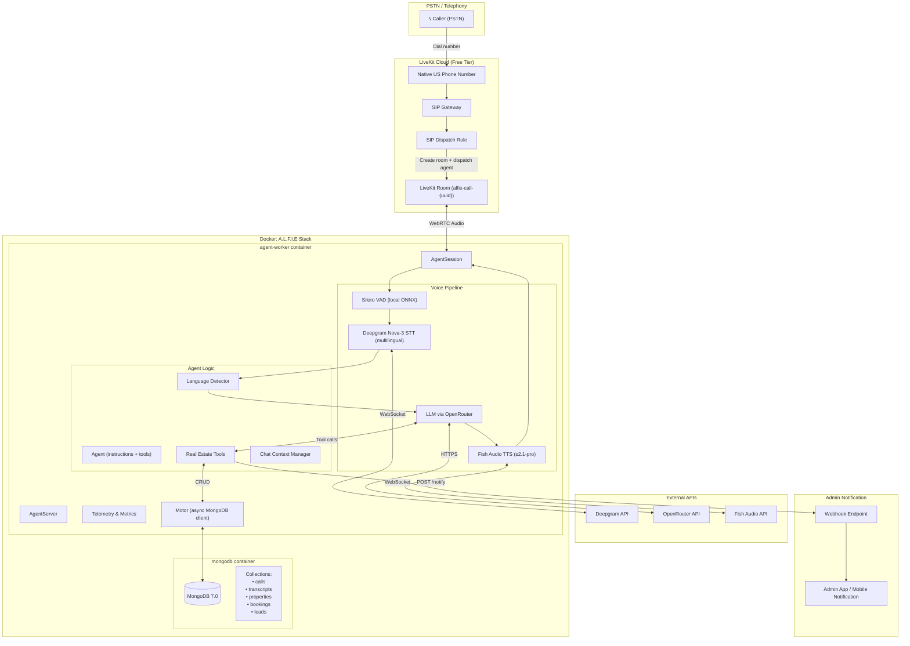
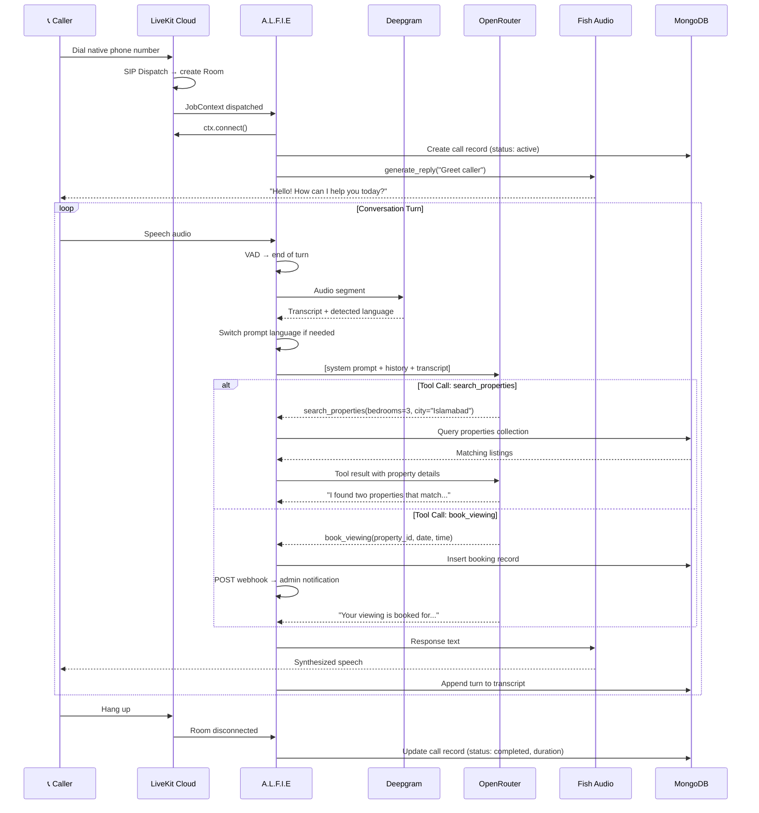
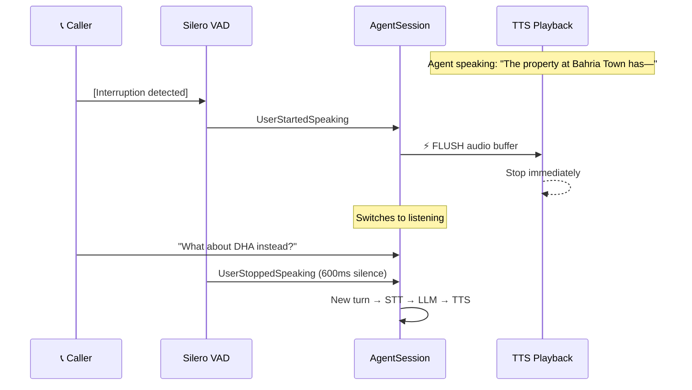
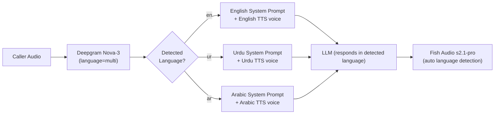
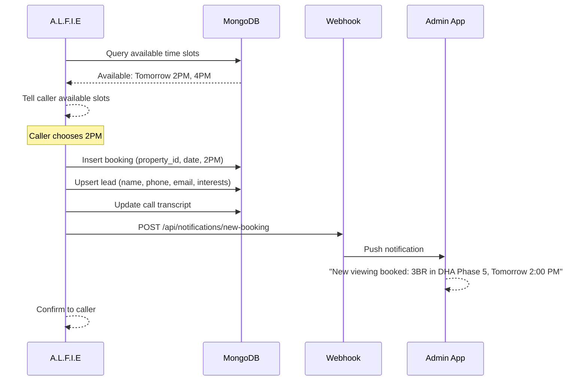
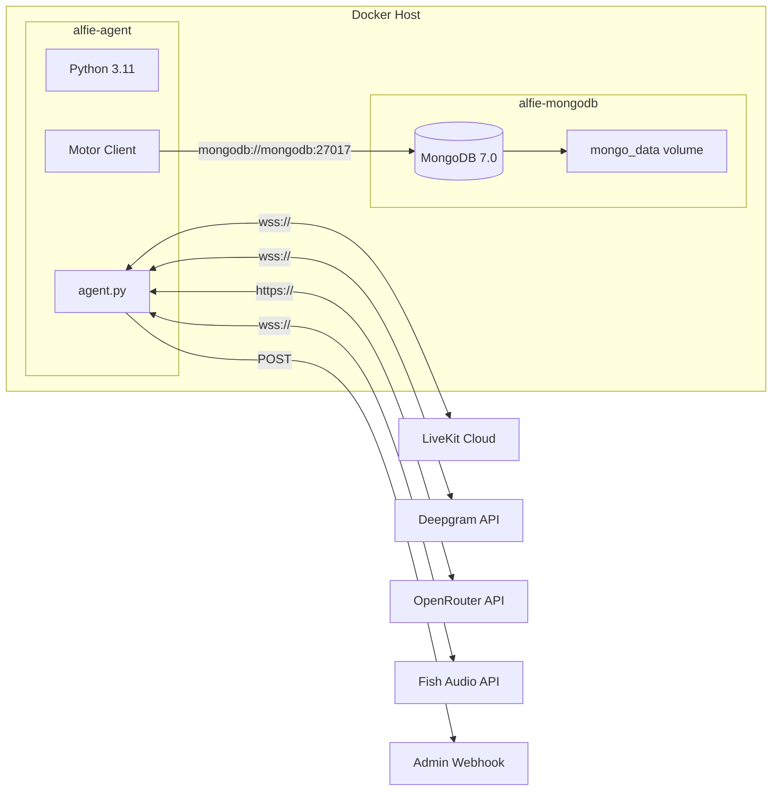

# A.L.F.I.E — System Architecture

**Version**: 3.0 | **Date**: 2026-08-04

---

## 1. System Overview

A.L.F.I.E (Autonomous LiveKit Framework for Intelligent Engagement) is a **multi-tenant, multi-niche** voice AI telephony platform. Each client (tenant) gets a fully configured, niche-specific voice agent — with its own phone number, system prompt, voice personality, and tool set — running on a shared platform core.

**Core Engine**: LiveKit Agents Python SDK (≥1.6)
**Languages**: English, Urdu, Arabic (per-tenant configurable)
**Active Niches**: Real Estate, Car Rental
**Architecture**: Modular — new verticals plug in without touching core code

### Key Architectural Principles

| Principle | How It's Applied |
|:----------|:-----------------|
| **Tenant isolation** | Every document carries `tenant_id`; queries are always scoped |
| **Niche modularity** | Tools, prompts, and data collections are organized per-vertical |
| **Dynamic tool loading** | Agent constructs its tool set at call start from `tool_registry` |
| **Provider flexibility** | STT, LLM, TTS providers configurable per-tenant in `agent_configs` |
| **Zero-downtime niche addition** | New vertical = new collections + tool implementations + registry entries |

---

## 2. High-Level Architecture



---

## 3. Voice Pipeline — Per-Turn Data Flow

```
Caller Audio → [Silero VAD] → Speech Segment
                                    ↓
                            [Deepgram Nova-3]
                          (language="multi")
                                    ↓
                        Transcript + Language Code
                                    ↓
                     [Language-Aware Prompt Selection]
                                    ↓
                        [OpenRouter LLM (Llama 3.3)]
                      system prompt + chat history
                                    ↓
                          ┌─────────┴─────────┐
                          │                   │
                    Direct Response      Tool Call
                          │            (@function_tool)
                          │                   │
                          │           Execute + DB ops
                          │                   │
                          └─────────┬─────────┘
                                    ↓
                        [Fish Audio TTS (s2.1-pro)]
                        (auto language detection)
                                    ↓
                          Audio Frames → Caller
```

---

## 4. Call Lifecycle



---

## 5. Interruption (Barge-In) Flow



---

## 6. Language Detection & Switching



**Strategy**:
- Deepgram Nova-3 with `language="multi"` auto-detects per utterance
- System prompt instructs LLM to mirror the caller's language
- Fish Audio s2.1-pro has built-in auto-detection (83 languages)
- No manual language switching required

---

## 7. Booking & Admin Notification Flow



---

## 8. Docker Deployment Topology



---

## 9. Technology Stack

| Layer | Provider | Model / Config | Protocol |
|:------|:---------|:---------------|:---------|
| **Transport** | LiveKit Cloud | Native phone + WebRTC | WebRTC / SIP |
| **VAD** | Silero | ONNX local model | Local inference |
| **STT** | Deepgram | Nova-3 (multi-language) | WebSocket |
| **LLM** | OpenRouter | llama-3.3-70b-instruct:free | HTTPS |
| **TTS** | Fish Audio | s2.1-pro (auto-detect) | WebSocket |
| **Database** | MongoDB | 7.0 (Docker) | TCP |
| **Deployment** | Docker Compose | Multi-container | — |
